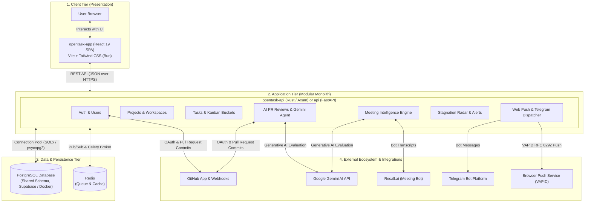

# OpenTask System Architecture

This document provides a comprehensive architectural overview of the **OpenTask** platform, detailing its architectural patterns, domain structure, data flow, and deployment topology.

---

## 1. Architectural Classification

OpenTask follows a **Decoupled 3-Tier Client-Server Architecture** implemented as a **Modular Monolith** inside a **Monorepo**.

| Architectural Dimension | Classification | Description |
| :--- | :--- | :--- |
| **System Paradigm** | **Client-Server (3-Tier)** | Decoupled Single-Page Application (SPA) frontend communicating over HTTPS REST API with a centralized backend server and shared database. |
| **Backend Architecture** | **Modular Monolith** | Single deployable backend binary/service where distinct business domains are structured into self-contained modules sharing one database. |
| **Repository Structure** | **Monorepo** | The frontend SPA, primary backend API, legacy API, and infrastructure configurations reside in a unified repository. |

---

## 2. Why Client-Server?

OpenTask strictly separates presentation concerns from data persistence and business logic:

1. **Client Tier (Browser / SPA)**:
   - **Path**: `opentask-app/`
   - **Stack**: React 19, TypeScript, Vite, Tailwind CSS v4, Bun.
   - **Role**: Renders the Neo-Brutalist user interface, manages client-side routing, handles local state (Kanban drag-and-drop, theme switching), and sends asynchronous JSON requests to the API.
2. **Application Server Tier (Modular Monolith)**:
   - **Path**: `opentask-api/` (Primary, Rust) / `api/` (Legacy, Python FastAPI).
   - **Role**: Manages authentication (GitHub OAuth), enforces authorization, runs AI prompt pipelines, schedules background tasks (Stagnation Radar), and proxies webhooks.
3. **Data Tier (PostgreSQL & Redis)**:
   - **Role**: Stores relational data (users, projects, tasks, buckets, meetings, alerts) and provides in-memory queuing/caching.

---

## 3. Why Modular Monolith (and Not Microservices)?

### Distinct Domain Modules in a Single Binary
Rather than splitting functionality into multiple independently deployed microservices, OpenTask groups business domains into cohesive modules within the same backend application:

```
opentask-api/src/
├── routes/
│   ├── auth.rs          # GitHub OAuth & user sessions
│   ├── users.rs         # User profiles & settings
│   ├── projects.rs      # Project workspaces & team memberships
│   ├── buckets.rs       # Kanban workflow columns & order
│   ├── tasks.rs         # Task CRUD, assignments, and story points
│   ├── pr_reviews.rs    # Pull Request AI evaluation records
│   ├── agent.rs         # Gemini LLM automated review agent
│   ├── meetings.rs      # Meeting Intelligence & MoM extraction
│   ├── alerts.rs        # Stagnation Radar & system alerts
│   ├── notifications.rs # Browser Web Push (VAPID)
│   └── telegram.rs      # Telegram notification bots
├── services/            # Business logic & external API clients
└── db/                  # SQLx database connection pooling & queries
```

### Contrast with Microservices:
- **Shared Database**: All domain tables reside within a single PostgreSQL database schema rather than isolated databases per domain (no *Database-per-Service* pattern).
- **In-Process Communication**: Communication between modules (e.g., triggering a notification upon task update) occurs via direct internal function calls or database transactions rather than network RPC/gRPC or an external event broker mesh.
- **Single Deployment Artifact**: The entire API compiles into a single executable Docker container, simplifying continuous deployment and eliminating network latency between services.

---

## 4. High-Level Architecture Diagram



---

## 5. Key Engineering Standards

1. **64-Bit Snowflake IDs (`SafeId`)**:
   - All primary keys (projects, buckets, tasks, alerts) are generated as 64-bit BigInts using Twitter-style Snowflake IDs.
   - To prevent precision loss in JavaScript (which caps integer precision at $2^{53} - 1$), the backend always serializes IDs as strings, and the frontend handles IDs strictly as `string`.
2. **Database Connection Pooling**:
   - Both Rust (`SQLx` pool) and Python (`psycopg2` pool) backends enforce pooled connection lifecycle management to avoid connection exhaustion under heavy load.
3. **Dual-Theme Neo-Brutalist UI**:
   - Frontend enforces sharp 0px border radius, heavy black borders, offset hard shadows, and strict contrast auditing across Dark and Light modes.

---

## 6. Deployment Topology

- **Frontend Hosting**: Deployed on **Vercel** (`opentask-app/dist`), utilizing `vercel.json` rewrites for reverse-proxying API calls when needed.
- **Backend Hosting**: Containerized via **Docker** and deployed on a VPS (DewaCloud) running the Axum/Tokio server on port `8000`.
- **Database**: Hosted managed **PostgreSQL** (Supabase) or local container via `docker-compose.yml`.
