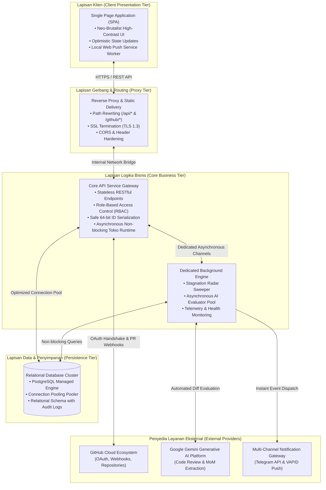
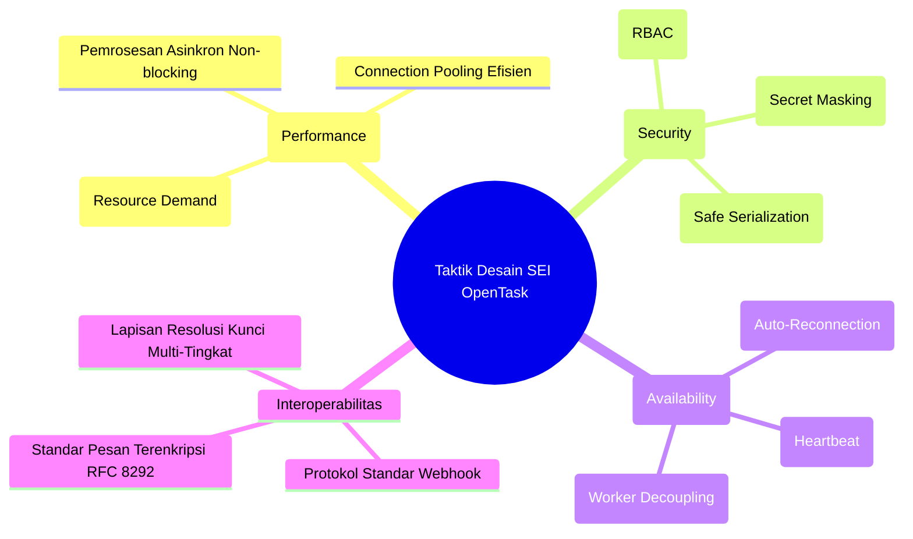
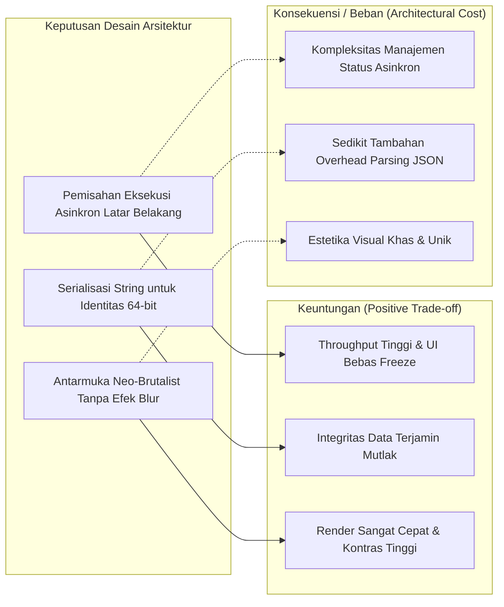

# DOKUMEN ARSITEKTUR DAN ATRIBUT KUALITAS SISTEM
## SPESIFIKASI ATRIBUT KUALITAS & TAKTIK ARSITEKTURAL — OPENTASK
### Versi Formal / Dokumen Presentasi & Evaluasi Akademik (SEI Standard)

```
                                    TELKOM UNIVERSITY
                                  FAKULTAS INFORMATIKA
                          PROGRAM STUDI S1 REKAYASA PERANGKAT LUNAK
                                      BANDUNG, 2026
```

---

## LEMBAR PENGESAHAN DOKUMEN

| Parameter | Keterangan |
| :--- | :--- |
| **Nama Sistem** | OpenTask Architecture & Quality Attributes Specification |
| **Nomor Dokumen** | ARCH-QA-OT-2026-V2 |
| **Metodologi Arsitektur** | Software Engineering Institute (SEI) Attribute-Driven Design (ADD) |
| **Tim Penyusun** | Evangelion Manuhutu (103022300164)|
| **Status Dokumen** | Disetujui untuk Presentasi & Penilaian Akhir |

---

# DAFTAR ISI

1. [BAGIAN 1: TINJAUAN ARSITEKTUR SISTEM KONSEPTUAL](#bagian-1-tinjauan-arsitektur-sistem-konseptual)
   - 1.1 Visi Arsitektur OpenTask
   - 1.2 Diagram Kontainer Tingkat Tinggi (C4 Container Level)
   - 1.3 Alur Integrasi Ekosistem Cerdas
2. [BAGIAN 2: UTILITY TREE & PRIORITISASI ASR](#bagian-2-utility-tree--prioritisasi-asr)
   - 2.1 Matriks Penentuan Prioritas ASR
   - 2.2 Pohon Utilitas Kualitas (Quality Utility Tree)
3. [BAGIAN 3: SKENARIO ATRIBUT KUALITAS FORMAL (SEI STANDAR)](#bagian-3-skenario-atribut-kualitas-formal-sei-standar)
   - Skenario 1: Performance — Pemuatan Data Skala Besar
   - Skenario 2: Performance — Throughput Evaluasi AI pada Webhook
   - Skenario 3: Security — Integritas ID Numerik & Perlindungan Akses Data (RBAC)
   - Skenario 4: Security — Isolasi Kredensial & Kerahasiaan Kunci Akses AI
   - Skenario 5: Availability — Ketahanan Koneksi Basis Data & Auto-Recovery
   - Skenario 6: Interoperability — Pengiriman Peringatan Multi-Kanal Instan
   - Skenario 7: Maintainability — Keamanan Tipe Statis & Modifikasi Komponen
   - Skenario 8: Usability — Responsivitas Visual & Standar Aksesibilitas Kontras
4. [BAGIAN 4: TAKTIK ARSITEKTURAL SISTEM (ARCHITECTURAL TACTICS)](#bagian-4-taktik-arsitektural-sistem-architectural-tactics)
   - 4.1 Taktik Kinerja (Performance Tactics)
   - 4.2 Taktik Keamanan (Security Tactics)
   - 4.3 Taktik Ketersediaan (Availability Tactics)
   - 4.4 Taktik Interoperabilitas (Interoperability Tactics)
   - 4.5 Taktik Kegunaan & Aksesibilitas (Usability Tactics)
   - 4.6 Taktik Pemeliharaan (Maintainability Tactics)
5. [BAGIAN 5: ANALISIS TRADE-OFF & EVALUASI RISIKO](#bagian-5-analisis-trade-off--evaluasi-risiko)
   - 5.1 Matriks Trade-Off Arsitektural
   - 5.2 Titik Sensitivitas & Titik Kompromi (Sensitivity & Trade-Off Points)
6. [BAGIAN 6: DAFTAR REFERENSI FORMAL](#bagian-6-daftar-referensi-formal)

---

# BAGIAN 1: TINJAUAN ARSITEKTUR SISTEM KONSEPTUAL

## 1.1 Visi Arsitektur OpenTask

Arsitektur **OpenTask** dirancang untuk memenuhi tuntutan platform manajemen proyek modern: **latensi rendah**, **keamanan tinggi**, **keandalan operasional**, dan **interoperabilitas mulus dengan kecerdasan buatan**. 

Sistem memadukan pola arsitektur **Layered Client-Server** dengan **Asynchronous Event-Driven Micro-Engine** untuk menangani tugas intensif I/O (seperti evaluasi kode oleh AI dan pemantauan tugas berkala) tanpa membebani antarmuka pengguna utama.

## 1.2 Diagram Kontainer Tingkat Tinggi (C4 Container Level)



## 1.3 Alur Integrasi Ekosistem Cerdas

Sistem memisahkan alur permintaan sinkron pengguna dari beban pemrosesan kecerdasan buatan:
1. **Permintaan Pengguna Sinkron**: Manajemen kartu Kanban, pengaturan kolom, dan pembaruan profil dilayani secara seketika dengan pembaruan status optimistik (*optimistic updates*).
2. **Pemrosesan Asinkron Latar Belakang**: Evaluasi *Pull Request* dan pemindaian *Stagnation Radar* dijalankan di jalur eksekusi terpisah (*worker threads*). Kegagalan atau penundaan jaringan pada layanan AI eksternal tidak akan menurunkan responsivitas navigasi pengguna.

---

# BAGIAN 2: UTILITY TREE & PRIORITISASI ASR

## 2.1 Matriks Penentuan Prioritas ASR

Kebutuhan Signifikan Arsitektur (*Architecturally Significant Requirements* / ASR) dibobot berdasarkan dua parameter utama:
- **Tingkat Kepentingan bagi Bisnis & Pengguna (Importance to Business: High/Medium/Low)**.
- **Tingkat Kompleksitas & Risiko Desain Arsitektur (Technical Architectural Difficulty: High/Medium/Low)**.

| Atribut Kualitas | Tingkat Kepentingan Bisnis | Risiko / Kompleksitas Arsitektur | Kategori Prioritas Gabungan |
| :--- | :---: | :---: | :---: |
| **Performance Efficiency** | High | High | **(High, High) — Kritis** |
| **Information Security** | High | High | **(High, High) — Kritis** |
| **System Availability** | High | Medium | **(High, Medium) — Tinggi** |
| **Interoperability** | High | Medium | **(High, Medium) — Tinggi** |
| **Maintainability** | High | Medium | **(High, Medium) — Tinggi** |
| **Usability & DevX** | Medium | Medium | **(Medium, Medium) — Moderat** |
| **Scalability** | Medium | Medium | **(Medium, Medium) — Moderat** |
| **Testability** | Medium | Low | **(Medium, Low) — Standar** |

## 2.2 Pohon Utilitas Kualitas (Quality Utility Tree)

```mermaid
graph TD
    UT["UTILITY TREE: OPENTASK"]

    %% Cabang Performance
    UT --> P["1. Performance"]
    P --> P1["P1: Latensi Render Kanban (H, H)"]
    P --> P2["P2: Throughput Evaluasi AI PR (H, H)"]

    %% Cabang Security
    UT --> S["2. Security"]
    S --> S1["S1: Proteksi Otorisasi RBAC & Anti-IDOR (H, H)"]
    S --> S2["S2: Integritas Numerik SafeId 64-bit (H, M)"]
    S --> S3["S3: Isolasi Kunci Akses & Token Rahasia (H, H)"]

    %% Cabang Availability
    UT --> A["3. Availability"]
    A --> A1["A1: Uptime Operasional 99.9% (H, M)"]
    A --> A2["A2: Pemulihan Otomatis Gangguan Basis Data (H, M)"]

    %% Cabang Interoperability
    UT --> I["4. Interoperability"]
    I --> I1["I1: Pemrosesan Webhook GitHub Real-Time (H, M)"]
    I --> I2["I2: Pengiriman Push VAPID & Telegram Bot (H, M)"]

    %% Cabang Usability & Maintainability
    UT --> U["5. Usability & Maintainability"]
    U --> U1["U1: Keterbacaan Kontras Tema Ganda WCAG AA (M, M)"]
    U --> U2["U2: Keamanan Tipe Data Statis Lintas Lapisan (M, M)"]
```



---

# BAGIAN 3: SKENARIO ATRIBUT KUALITAS FORMAL (SEI STANDAR)

Setiap skenario didefinisikan menggunakan enam elemen formal standar SEI (*Software Engineering Institute*): **Source of Stimulus**, **Stimulus**, **Artifact**, **Environment**, **Response**, dan **Response Measure**.

### Skenario 1: Performance — Pemuatan Papan Kanban Skala Besar
| Elemen SEI | Rincian Spesifikasi |
| :--- | :--- |
| **Source of Stimulus** | Pengguna akhir (Developer atau Project Manager) melalui peramban web. |
| **Stimulus** | Membuka halaman detail proyek yang memuat 5 kolom alur kerja dan $>200$ tiket tugas aktif. |
| **Artifact** | Modul Layanan Data Papan (*Board Data Service*) dan Komponen Tampilan Kanban. |
| **Environment** | Operasi normal sistem pada jam kerja dengan latensi jaringan internet rata-rata. |
| **Response** | Sistem mengeksekusi kueri terindeks, memetakan data relasional, mengalirkan payload JSON berbobot ringan, dan merender antarmuka tanpa pembekuan visual. |
| **Response Measure** | Latensi respons API $\le 120\text{ ms}$; waktu pemuatan interaktif (FCP) $\le 450\text{ ms}$; transisi animasi *drag-and-drop* berjalan stabil pada level 60 frame per detik (FPS). |

### Skenario 2: Performance — Throughput Evaluasi AI pada Webhook
| Elemen SEI | Rincian Spesifikasi |
| :--- | :--- |
| **Source of Stimulus** | Server Webhook GitHub saat ada *Pull Request* baru dibuka oleh pengembang. |
| **Stimulus** | Pengiriman muatan webhook berisi metadata cabang dan berkas *patch code diff* hingga 500 baris. |
| **Artifact** | Modul Evaluator PR Otomatis dan Gerbang Layanan Kecerdasan Buatan. |
| **Environment** | Kondisi beban kerja aktif bersamaan (*concurrent incoming traffic*). |
| **Response** | Gerbang API segera mengembalikan status penerimaan webhook, mendelegasikan analisis ke pekerja asinkron, membandingkan kode dengan deskripsi tugas, dan mengeposkan ulasan ke GitHub. |
| **Response Measure** | Respons awal *handshake* ke GitHub $\le 200\text{ ms}$; evaluasi lengkap beserta skor kelengkapan dan komentar terbit di GitHub dalam waktu total $\le 8\text{ detik}$. |

### Skenario 3: Security — Integritas ID Numerik & Perlindungan Akses Data (RBAC)
| Elemen SEI | Rincian Spesifikasi |
| :--- | :--- |
| **Source of Stimulus** | Klien eksternal tanpa hak akses resmi atau upaya manipulasi parameter (*Insecure Direct Object Reference* / IDOR). |
| **Stimulus** | Mengirimkan instruksi pembaruan atau penghapusan tugas menggunakan ID numerik 64-bit yang sah milik proyek organisasi lain. |
| **Artifact** | Komponen Otorisasi Berbasis Peran (*RBAC Extractor*) dan Skema Identitas 64-bit. |
| **Environment** | Sistem daring yang terpapar ke jaringan publik. |
| **Response** | Sistem melakukan validasi token sesi, mencocokkan keanggotaan pengguna terhadap proyek pemilik tugas, menolak akses tidak sah, dan menjamin identitas 64-bit diserialisasikan secara presisi tanpa distorsi angka. |
| **Response Measure** | Akses tidak sah digagalkan seketika dengan status HTTP `403 Forbidden` dalam waktu $\le 25\text{ ms}$; tingkat toleransi kesalahan presisi numerik adalah nol (*zero precision loss*). |

### Skenario 4: Security — Isolasi Kredensial & Kerahasiaan Kunci Akses AI
| Elemen SEI | Rincian Spesifikasi |
| :--- | :--- |
| **Source of Stimulus** | Pengguna reguler atau aktor ancaman yang mencoba mengekstraksi konfigurasi rahasia proyek. |
| **Stimulus** | Mengakses endpoint informasi proyek atau mencoba mengunduh payload data konfigurasi. |
| **Artifact** | Lapisan Serialisasi Data Entitas Proyek dan Modul Konfigurasi Kunci AI. |
| **Environment** | Lingkungan kerja multi-tenant di mana setiap proyek dapat memiliki kunci AI mandiri. |
| **Response** | Sistem secara otomatis mengecualikan nilai kunci API rahasia dari skema keluaran publik, serta menerapkan protokol penyamaran karakter (*character masking*) pada antarmuka manajemen. |
| **Response Measure** | 100% kunci API terisolasi dari kebocoran data; upaya inspeksi inspeksi jaringan hanya menampilkan token tersamar (`sk-***xxxx`). |

### Skenario 5: Availability — Ketahanan Koneksi Basis Data & Auto-Recovery
| Elemen SEI | Rincian Spesifikasi |
| :--- | :--- |
| **Source of Stimulus** | Infrastruktur klaster basis data awan (*Cloud Database Engine*). |
| **Stimulus** | Terjadi kegagalan jaringan transien (*network blip*) atau pemutusan koneksi sepihak oleh *transaction pooler*. |
| **Artifact** | Modul Manajemen Kolam Koneksi (*Connection Pool Manager*). |
| **Environment** | Jam sibuk operasional dengan volume kueri aktif tinggi. |
| **Response** | Lapisan koneksi mendeteksi koneksi terputus, mengisolasi galat agar tidak mematikan server (*no crash/panic*), dan secara proaktif menginisiasi koneksi ulang secara otomatis. |
| **Response Measure** | Pemulihan koneksi kolam secara mandiri selesai dalam waktu $\le 3\text{ detik}$; tingkat ketersediaan layanan (*availability uptime*) tahunan tetap tercapai minimal 99.9%. |

### Skenario 6: Interoperability — Pengiriman Peringatan Multi-Kanal Instan
| Elemen SEI | Rincian Spesifikasi |
| :--- | :--- |
| **Source of Stimulus** | Pekerja Latar Belakang Radar Pemantau Tugas Mandek (*Stagnation Radar Worker*). |
| **Stimulus** | Suatu tugas terdeteksi menganggur dalam status aktif tanpa ada rekaman komit atau PR selama $>48$ jam. |
| **Artifact** | Subsistem Notifikasi Multi-Kanal (Gateway Web Push VAPID & Bot Telegram). |
| **Environment** | Pengembang yang bersangkutan sedang tidak aktif membuka peramban web OpenTask. |
| **Response** | Sistem menyusun pesan peringatan terstruktur, mendistribusikannya melalui kanal Web Push ke perangkat terdaftar, dan mengirimkan pesan teks instan ke akun Telegram pengguna. |
| **Response Measure** | Pesan peringatan tiba di perangkat pengguna dalam waktu $\le 3\text{ detik}$ setelah radar mendeteksi kondisi stagnan; tingkat keberhasilan pengiriman (*delivery rate*) $\ge 98\%$. |

### Skenario 7: Maintainability — Keamanan Tipe Statis & Modifikasi Komponen
| Elemen SEI | Rincian Spesifikasi |
| :--- | :--- |
| **Source of Stimulus** | Tim Pengembang OpenTask (Maintenance / Feature Extension). |
| **Stimulus** | Penambahan atribut baru pada entitas tugas atau penambahan varian komponen baru pada *Design System*. |
| **Artifact** | Kontrak Antarmuka Komponen (*Design System Tokens*) dan Model Domain Sistem. |
| **Environment** | Siklus integrasi berkelanjutan (*Continuous Integration Pipeline*). |
| **Response** | Kompiler statis memvalidasi seluruh kontrak tipe data secara otomatis, mencegah ketidaksesuaian kontrak data (*breaking changes*) sebelum sistem dideploy. |
| **Response Measure** | Waktu verifikasi kompilasi penuh $\le 30\text{ detik}$; tidak ditemukan *runtime type regression error* pada lingkungan produksi pasca-integrasi. |

### Skenario 8: Usability — Responsivitas Visual & Standar Aksesibilitas Kontras
| Elemen SEI | Rincian Spesifikasi |
| :--- | :--- |
| **Source of Stimulus** | Pengguna akhir yang berpindah preferensi tema tampilan (Gelap $\leftrightarrow$ Terang). |
| **Stimulus** | Menekan tombol sakelar tema pada antarmuka pengguna di tengah aktivitas kerja. |
| **Artifact** | Modul Manajemen Tema (*Theme Controller*) dan Komponen Desain Neo-Brutalist. |
| **Environment** | Penggunaan pada berbagai kondisi pencahayaan layar (ruangan terang maupun gelap). |
| **Response** | Seluruh palet warna antarmuka, batas kontras (*hard borders*), bayangan (*hard shadows*), dan teks berubah seketika tanpa *flickering* atau pemuatan ulang halaman. |
| **Response Measure** | Waktu propagasi perubahan tema $\le 50\text{ ms}$; seluruh rasio kontras teks terhadap bidang latar belakang memenuhi standar minimum aksesibilitas WCAG 2.1 AA ($\ge 4.5:1$). |

---

# BAGIAN 4: TAKTIK ARSITEKTURAL SISTEM (ARCHITECTURAL TACTICS)

Penerapan taktik arsitektural mengacu pada taktik formal SEI (*Bass, Clements, & Kazman*):



## 4.1 Taktik Kinerja (Performance Tactics)
1. **Manajemen Beban & Pemrosesan Asinkron (*Manage Resource Demand & Concurrency*)**:
   - Memisahkan operasi I/O berlatensi tinggi (seperti evaluasi AI eksternal) dari alur transaksi utama menggunakan antrean tugas asinkron latar belakang.
2. **Efisiensi Kolam Koneksi (*Connection Pooling Reuse*)**:
   - Mengelola kolam koneksi basis data persisten yang menggunakan kembali koneksi aktif, menonaktifkan *statement caching* lokal untuk mencegah konflik dengan perantara *transaction pooler*.
3. **Pembaruan Status Optimistik (*Optimistic UI State Updating*)**:
   - Memperbarui representasi visual kartu tugas pada memori antarmuka seketika saat tindakan dilakukan oleh pengguna, lalu menyinkronkan status ke peladen di latar belakang.

## 4.2 Taktik Keamanan (Security Tactics)
1. **Otorisasi dan Pembatasan Akses (*Restrict Access via RBAC*)**:
   - Menerapkan gerbang verifikasi peran (*Manager, Developer, Designer*) di setiap titik masuk API sebelum data proyek atau tugas dimutasi.
2. **Penjaminan Integritas Serialisasi (*Data Integrity Enforcement*)**:
   - Menerapkan format representasi string khusus untuk seluruh identitas bilangan bulat 64-bit guna mencegah kerentanan pemotongan data akibat batas presisi *floating point* JavaScript.
3. **Penyembunyian Informasi Rahasia (*Information Hiding & Masking*)**:
   - Mengecualikan atribut kunci API AI dan token instalasi dari skema serialisasi publik, serta menerapkan algoritma penyamaran karakter pada antarmuka pengguna.

## 4.3 Taktik Ketersediaan (Availability Tactics)
1. **Deteksi dan Pemulihan Mandiri (*Fault Detection & Reconnection*)**:
   - Memantau kondisi konektivitas basis data secara berkelanjutan dan melakukan negosiasi koneksi ulang secara mandiri jika terdeteksi gangguan koneksi sementara.
2. **Isolasi Kegagalan Subsistem (*Fault Containment & Graceful Degradation*)**:
   - Kegagalan komunikasi atau kehabisan kuota pada layanan AI pihak ketiga diisolasi pada tugas yang bersangkutan, tanpa mengganggu operasional papan Kanban dan manajemen tugas lainnya.

## 4.4 Taktik Interoperabilitas (Interoperability Tactics)
1. **Penerimaan Peristiwa Berstandar (*Standardized Webhook Ingestion*)**:
   - Menerima dan memvalidasi muatan data peristiwa dari ekosistem GitHub melalui mekanisme verifikasi identitas instalasi.
2. **Komunikasi Berstandar Terbuka (*Open Standards Compliance*)**:
   - Memanfaatkan protokol Web Push VAPID yang mematuhi standar IETF RFC 8291 dan RFC 8292 untuk transmisi notifikasi peramban lintas platform.

## 4.5 Taktik Kegunaan & Aksesibilitas (Usability Tactics)
1. **Integritas Desain Terstandarisasi (*Design System Consistency*)**:
   - Mengelompokkan seluruh elemen antarmuka ke dalam komponen atomik terpadu yang mematuhi geometri Neo-Brutalist dan palet warna kontras tinggi.
2. **Aksesibilitas Kontras Ganda (*Universal Dual-Theme Contrast*)**:
   - Mengatur variabel warna menggunakan token terpusat untuk menjamin keterbacaan teks di semua kondisi pencahayaan peramban.

## 4.6 Taktik Pemeliharaan (Maintainability Tactics)
1. **Pemisahan Perhatian (*Separation of Concerns*)**:
   - Membagi kode sistem ke dalam lapisan modular: *Gateway/Routes*, *Business Domain Services*, *Data Access Layer*, dan *Presentation Components*.
2. **Pengecekan Tipe Statis (*Compile-Time Type Safety*)**:
   - Menerapkan sistem pengetikan statis ketat di seluruh lapisan backend dan frontend guna mendeteksi ketidaksesuaian kontrak data sebelum tahap rilis.

---

# BAGIAN 5: ANALISIS TRADE-OFF & EVALUASI RISIKO



## 5.1 Matriks Trade-Off Arsitektural

| Keputusan Arsitektur | Atribut Kualitas Diuntungkan | Atribut Kualitas Dikompromikan | Mitigasi Dampak Kompromi |
| :--- | :--- | :--- | :--- |
| **Pemrosesan Asinkron untuk Evaluasi AI** | **Performance & Availability** (UI tetap responsif) | **Maintainability** (Perlu penanganan alur status asinkron) | Menerapkan model data status ulasan dengan transisi status yang terdefinisi (*Pending $\rightarrow$ Evaluated*). |
| **Representasi String untuk SafeId 64-bit** | **Security & Data Integrity** (Tidak ada pembulatan angka) | **Performance** (Konversi tipis antara teks dan bilangan 64-bit) | Dijalankan pada tahap serialisasi data tingkat rendah dengan optimasi *zero-copy parsing*. |
| **Antarmuka Neo-Brutalist Tanpa Efek Blur** | **Performance & Usability** (Beban GPU rendah, kontras tajam) | **Subjective Aesthetics** (Gaya visual tajam tidak konvensional) | Standarisasi token desain terpusat dan penyediaan tema ganda (Gelap & Terang). |

## 5.2 Titik Sensitivitas & Titik Kompromi (Sensitivity & Trade-Off Points)
- **Titik Sensitivitas (Sensitivity Point)**: Latensi evaluasi *Pull Request* sangat sensitif terhadap kecepatan respons API model bahasa eksternal (Google Gemini).
  - *Solusi Arsitektural*: Menggunakan model performa kilat (`gemini-2.5-flash`) dan menjalankan proses secara murni di latar belakang.
- **Titik Kompromi (Trade-Off Point)**: Penggunaan *connection pooling* tanpa *statement caching* memprioritaskan stabilitas integrasi terhadap *transaction poolers* awan dengan sedikit mengorbankan kecepatan persiapan kueri mikro-detik.

---

# BAGIAN 6: DAFTAR REFERENSI FORMAL

1. **Bass, L., Clements, P., & Kazman, R.** (2021). *Software Architecture in Practice (4th Edition)*. SEI Series in Software Engineering, Addison-Wesley Professional.
2. **ISO/IEC/IEEE 25010:2023**. *Systems and software engineering — Systems and software Quality Requirements and Evaluation (SQuaRE) — Product quality model*.
3. **Clements, P., Kazman, R., & Klein, M.** (2002). *Evaluating Software Architectures: Methods and Case Studies*. Addison-Wesley.
4. **World Wide Web Consortium (W3C)** (2018). *Web Content Accessibility Guidelines (WCAG) 2.1*. W3C Recommendation.
5. **Internet Engineering Task Force (IETF)** (2017). *RFC 8292: Voluntary Application Server Identification (VAPID) for Web Push*.
