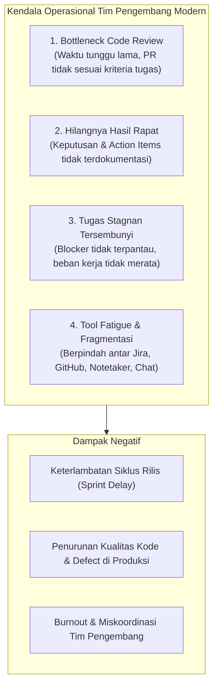
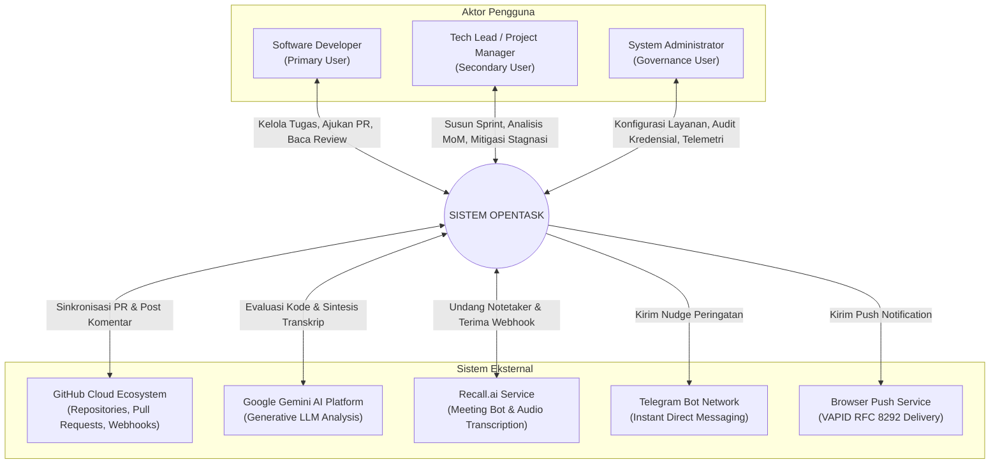
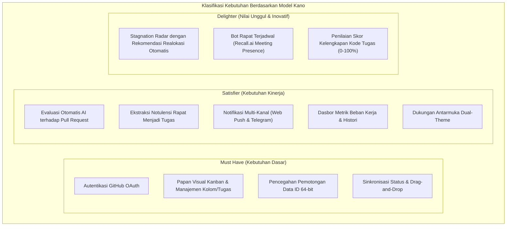
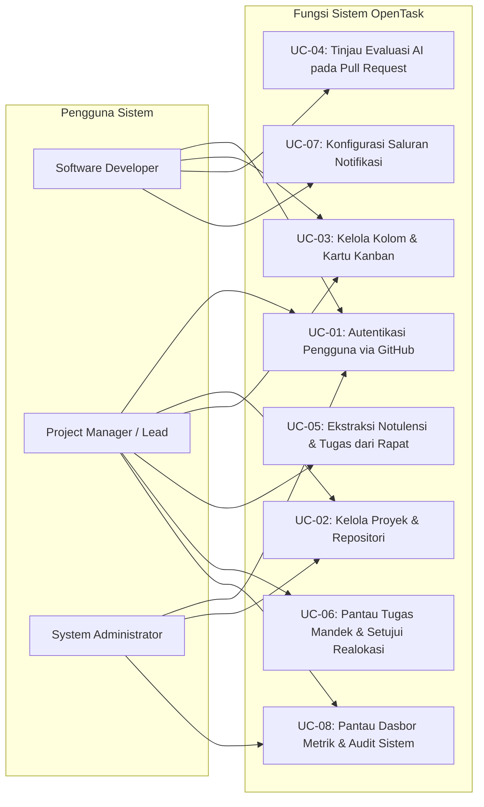
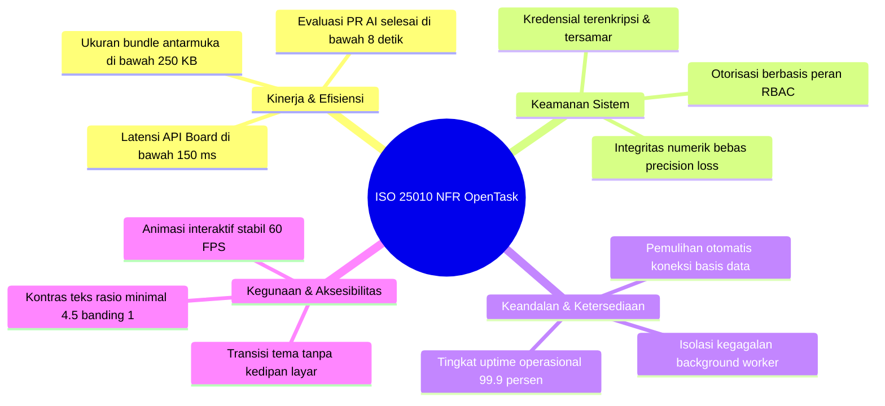

# DOKUMEN PERANCANGAN KEBUTUHAN PERANGKAT LUNAK (RKPL)
## SISTEM MANAJEMEN PROYEK CERDAS TERINTEGRASI AI — OPENTASK
### Versi Formal / Dokumen Presentasi & Evaluasi Akademik

```
                                    TELKOM UNIVERSITY
                                  FAKULTAS INFORMATIKA
                          PROGRAM STUDI S1 REKAYASA PERANGKAT LUNAK
                                      BANDUNG, 2026
```

---

## LEMBAR PENGESAHAN DOKUMEN

| Parameter | Keterangan |
| :--- | :--- |
| **Nama Proyek** | OpenTask — Intelligent Agile Project Management Platform |
| **Nomor Dokumen** | RKPL-OT-2026-V2 |
| **Mata Kuliah** | Rekayasa Kebutuhan Perangkat Lunak / Software Requirements Engineering |
| **Tim Penyusun** | Evangelion Manuhutu (103022300164)|
| **Status Dokumen** | Disetujui untuk Presentasi & Penilaian Akhir |
| **Klasifikasi Akses** | Terbuka / Akademik & Profesional |

---

# DAFTAR ISI

1. [BAB I: DESKRIPSI SISTEM DAN STUDI KASUS](#bab-i-deskripsi-sistem-dan-studi-kasus)
   - 1.1 Latar Belakang & Pernyataan Masalah
   - 1.2 Tujuan Proyek
   - 1.3 Deskripsi Solusi: OpenTask
   - 1.4 Batasan dan Asumsi Sistem (System Boundary & Assumptions)
   - 1.5 Model Konteks & Analisis Stakeholder
   - 1.6 Karakteristik Pengguna & Persona
2. [BAB II: AKTIVITAS ELISITASI KEBUTUHAN](#bab-ii-aktivitas-elisitasi-kebutuhan)
   - 2.1 Metodologi & Rencana Kerja Elisitasi
   - 2.2 Studi Komparasi Sistem Serupa (Document-Centric Reuse)
   - 2.3 Analisis Kuesioner Pengguna
   - 2.4 Hasil Wawancara Mendalam (In-Depth Interviews)
   - 2.5 Sintesis Kebutuhan dengan Model Kano
3. [BAB III: SPESIFIKASI KEBUTUHAN PERANGKAT LUNAK](#bab-iii-spesifikasi-kebutuhan-perangkat-lunak)
   - 3.1 Model Konseptual & Diagram Use Case
   - 3.2 Narasi Use Case Utama
   - 3.3 Daftar Kebutuhan Fungsional (Functional Requirements)
   - 3.4 Daftar Kebutuhan Non-Fungsional (Non-Functional Requirements / ISO 25010)
4. [BAB IV: MATRIKS KETERTELUSURAN & LAMPIRAN](#bab-iv-matriks-ketertelusuran--lampiran)
   - 4.1 Traceability Matrix (Tujuan Bisnis $\rightarrow$ Kebutuhan Fungsional)
   - 4.2 Notulensi Rapat Penyusunan Kebutuhan (Minutes of Meeting)

---

# BAB I: DESKRIPSI SISTEM DAN STUDI KASUS

## 1.1 Latar Belakang & Pernyataan Masalah

Dalam industri rekayasa perangkat lunak modern, metodologi *Agile* menuntut iterasi yang cepat, komunikasi intensif, dan transparansi tugas yang tinggi. Namun, realitas operasional pada tim pengembang sering kali terhambat oleh empat masalah mendasar:



1. **Bottleneck Code Review**: Waktu tunggu tinjauan kode (*Pull Request*) oleh *Lead Developer* sering kali memakan waktu berhari-hari. Selain itu, sering ditemukan kode yang diajukan tidak memenuhi kriteria penerimaan (*acceptance criteria*) dari tugas terkait, yang menyebabkan revisi berulang yang tidak efisien.
2. **Hilangnya Nilai Tindak Lanjut Rapat (Meeting Inefficacy)**: Rapat perencanaan *sprint* dan diskusi arsitektur menghasilkan banyak poin penting, namun dokumentasi notulensi sering kali terabaikan dan tidak pernah diubah menjadi tiket tugas terstruktur pada papan manajemen tugas.
3. **Tugas Stagnan Tanpa Radar Dini (Task Stagnation)**: Banyak tugas yang diambil pengembang terhenti (*idle*) lebih dari 48 jam akibat kendala teknis yang tidak segera dilaporkan. Manajer proyek kerap terlambat mengetahui kendala ini hingga rapat evaluasi akhir *sprint*.
4. **Kelelahan Alat (Tool Fatigue)**: Tim harus berganti-ganti aplikasi secara konstan—mulai dari papan tugas yang berat dan lambat, antarmuka repositori kode, alat transkrip rapat terpisah, hingga aplikasi perpesanan instan—yang menurunkan produktivitas pengembang secara drastis (*context-switching penalty*).

## 1.2 Tujuan Proyek

Pengembangan platform **OpenTask** memiliki sasaran strategis:
1. **Otomasi Tinjauan Spesifikasi Kode**: Mengintegrasikan kecerdasan buatan (*Artificial Intelligence*) untuk memvalidasi kelengkapan *Pull Request* terhadap kriteria tugas secara otomatis dalam hitungan detik.
2. **Transformasi Hasil Rapat Menjadi Tindakan Nyata**: Menyediakan modul *Meeting Intelligence* yang mengekstraksi ringkasan eksekutif, keputusan penting, dan daftar tugas aksi dari transkrip rapat ke papan Kanban secara instan.
3. **Visibilitas dan Mitigasi Tugas Mandek Secara Proaktif**: Menghadirkan sistem pemantau aktif (*Stagnation Radar*) yang mendeteksi tugas tanpa kemajuan dalam kurun waktu 48 jam dan merekomendasikan solusi penugasan ulang.
4. **Antarmuka Terpusat, Ergonomis, dan Berkecepatan Tinggi**: Menyajikan pengalaman pengguna bertema *Neo-Brutalist* yang berbobot ringan, berdaya respons tinggi, serta memiliki keterbacaan optimal pada kondisi terang maupun gelap (*Dual-Theme*).

## 1.3 Deskripsi Solusi: OpenTask

**OpenTask** adalah sistem manajemen proyek dan pelacak tugas berbasis web terintegrasi kecerdasan buatan (*AI-Native Agile Project Management Platform*). OpenTask menggabungkan manajemen alur kerja visual dengan otomatisasi ekosistem Git dan kecerdasan analitik.

```mermaid
graph LR
    subgraph UserInterface ["Antarmuka Neo-Brutalist"]
        KB["Kanban Board & Timelines"]
        MI["Meeting Intelligence Tab"]
        SR["Stagnation Radar Panel"]
    end

    subgraph CoreEngine ["OpenTask Core Engine"]
        TM["Task & Bucket Orchestrator"]
        AI["AI Evaluation & NLP Engine"]
        NT["Multi-Channel Notification Dispatcher"]
        ID["Safe 64-bit ID Manager"]
    end

    subgraph ExternalEcosystem ["Ekosistem Eksternal"]
        GH["GitHub App & Webhooks"]
        LLM["Google Gemini AI Service"]
        TP["Telegram Bot & Web Push"]
    end

    UserInterface <--> CoreEngine
    CoreEngine <--> ExternalEcosystem
```



### Pilar Solusi Utama:
1. **Interactive Kanban Board**: Manajemen kolom alur kerja fleksibel dengan penataan tugas berbasis prioritas, bobot (*story points*), dan pembaruan visual instan.
2. **GitHub App & Automated AI PR Reviewer**: Hubungan dwiarah antara tugas dengan cabang (*branch*) dan *Pull Request* GitHub. AI mengevaluasi kesesuaian kode, menghasilkan skor kelengkapan (0–100%), vonis (*PASS/FAIL*), dan memberikan komentar umpan balik otomatis pada repositori.
3. **Meeting Intelligence Engine**: Modul pemroses bahasa alami yang menyintesis rekaman/transkrip rapat menjadi ringkasan rapat terstruktur serta butir tindakan (*action items*) yang dapat langsung dikonversi menjadi kartu tugas Kanban.
4. **Stagnation Radar & Smart Task Reallocation**: Pengawasan latar belakang otomatis yang mendeteksi tugas tidak aktif dalam status *Ongoing* dan memberikan rekomendasi pengalihan tugas kepada anggota tim dengan kapasitas kerja paling lapang.
5. **Multi-Channel Notification System**: Saluran peringatan langsung ke peramban pengguna (*Web Push*) dan aplikasi pesan (*Telegram*) untuk memangkas waktu tunggu tindak lanjut.

## 1.4 Batasan dan Asumsi Sistem (Boundary & Assumptions)

### Batasan Sistem (Boundaries)
1. **Integrasi Git**: Dikhususkan pada repositori yang di-hosting di **GitHub** (GitHub Cloud / Enterprise).
2. **Kecerdasan Buatan**: Menggunakan layanan model bahasa **Google Gemini API** yang memerlukan konektivitas internet aktif.
3. **Autentikasi Pengguna**: Berbasis akun pengembang resmi melalui protokol **GitHub OAuth**.
4. **Notifikasi Dorong**: Fitur *Web Push* mengandalkan peramban modern yang mematuhi standar W3C Service Worker dan Push API.
5. **Kerahasiaan Kredensial**: Sistem tidak menyimpan kata sandi repositori pengguna secara langsung, melainkan menggunakan token instalasi aman (*Installation Token*) berbasis GitHub App.

### Asumsi Sistem (Assumptions)
1. Tim pengembang menggunakan Git dengan pola alur kerja berbasis *feature branch* atau *pull request*.
2. Pengguna memiliki akses koneksi internet stabil untuk sinkronisasi webhook dan pemanggilan API eksternal.
3. Browser yang digunakan oleh klien mendukung standar HTML5, CSS Grid/Flexbox, dan JavaScript ES2022+.

## 1.5 Model Konteks & Analisis Stakeholder

Sistem OpenTask beroperasi di tengah interaksi antara aktor manusia dan sistem eksternal:



## 1.6 Karakteristik Pengguna & Persona

### Persona 1: Primary User — Software Developer
- **Nama**: Arya Wijaya (25 Tahun)
- **Peran**: Full-Stack Web Developer
- **Karakteristik**: Berorientasi pada efisiensi penulisan kode, tidak menyukai birokrasi tiket yang berbelit-belit, mengutamakan umpan balik teknis yang cepat.
- **Goals**: Ingin segera mengetahui apakah kode yang dibuat sudah sesuai spesifikasi tugas sebelum direview rekan setim, serta mendapatkan notifikasi cepat tanpa membuka email.
- **Pain Points**: Menunggu review PR terlalu lama; sering lupa memperbarui status tugas manual di aplikasi eksternal.

### Persona 2: Secondary User — Technical Project Manager
- **Nama**: Maya Saraswati (32 Tahun)
- **Peran**: Lead Project Manager & Scrum Master
- **Karakteristik**: Bertanggung jawab atas ketepatan jadwal rilis *sprint*, koordinasi tim lintas disiplin, dan alokasi kapasitas anggota.
- **Goals**: Memastikan hasil diskusi rapat langsung menjadi tugas yang jelas dan mendeteksi tugas mandek sedini mungkin sebelum menghambat *sprint*.
- **Pain Points**: Menghabiskan 1–2 jam setelah setiap rapat hanya untuk merapikan notulensi dan membagi tiket; kesulitan memantau tugas yang diam-diam mengalami *blocker*.

---

# BAB II: AKTIVITAS ELISITASI KEBUTUHAN

## 2.1 Metodologi & Rencana Kerja Elisitasi

Aktivitas elisitasi kebutuhan perangkat lunak OpenTask dilaksanakan menggunakan kombinasi tiga teknik komplementer:
1. **Document-Centric Reuse**: Membedah fitur dan alur kerja platform industri eksisting.
2. **Kuesioner Kuantitatif**: Mengumpulkan data empiris dari 65 praktisi pengembang perangkat lunak.
3. **Wawancara Terstruktur**: Menyelidiki akar masalah (*root cause*) bersama Developer, Project Manager, dan DevOps Engineer.

## 2.2 Studi Komparasi Sistem Serupa (Document-Centric Reuse)

| Parameter Evaluasi | Jira Software | Linear App | GitHub Projects | Trello | **OpenTask (Usulan)** |
| :--- | :---: | :---: | :---: | :---: | :---: |
| **Kecepatan Antarmuka** | Rendah (Berat) | Sangat Tinggi | Sedang | Tinggi | **Sangat Tinggi (Neo-Brutalist)** |
| **Koneksi Native Git Branch** | Melalui Add-on | Terintegrasi | Native | Melalui Power-Up | **Native & Otomatis** |
| **Automated AI Code Review** | Tidak Ada | Tidak Ada | Terbatas | Tidak Ada | **Tersedia (Gemini Evaluator)** |
| **Meeting Intelligence (MoM $\to$ Task)** | Tidak Ada | Tidak Ada | Tidak Ada | Tidak Ada | **Tersedia (Otomatis)** |
| **Stagnation Radar & Reallocation** | Tidak Ada | Tidak Ada | Tidak Ada | Tidak Ada | **Tersedia (>48h Idle Detection)** |
| **Saluran Notifikasi** | Email / In-App | In-App / Slack | In-App / Email | In-App / Email | **Web Push & Telegram Bot** |
| **Integritas Safe 64-bit ID** | Internal ID | UUID v4 | Internal Node ID | MongoDB ID | **Twitter Snowflake SafeId** |

## 2.3 Analisis Kuesioner Pengguna

Survei disebarkan kepada 65 responden praktisi rekayasa perangkat lunak:
- **81.5%** menyatakan bahwa waktu tunggu peninjauan *Pull Request* sering menjadi penghambat utama jadwal pengiriman fitur.
- **73.8%** menyatakan butuh waktu antara 30 hingga 60 menit setelah rapat teknis hanya untuk merumuskan ulang poin pembicaraan ke dalam kartu tugas.
- **69.2%** pernah mengalami kegagalan *sprint* akibat tugas yang mengalami *blocker* tersembunyi tanpa diketahui manajer proyek.
- **89.2%** menilai fitur evaluasi kode otomatis oleh AI yang langsung memberikan skor kelengkapan dan feedback di GitHub sebagai kebutuhan yang sangat bernilai tinggi.
- **84.6%** memprioritaskan saluran Telegram dan Web Push Browser dibandingkan email konvensional untuk notifikasi darurat.

## 2.4 Hasil Wawancara Mendalam (In-Depth Interviews)

### Intisari Wawancara:
1. **Perspektif Pengembang**:
   - Membutuhkan proses pelaporan tugas yang seringkas mungkin.
   - Menginginkan *early feedback* sebelum *Senior Engineer* melakukan *human review* pada *Pull Request*.
2. **Perspektif Project Manager**:
   - Mengharapkan otomasi pembuatan tiket dari sesi *daily standup* dan *planning*.
   - Memerlukan mekanisme peringatan dini (*early warning system*) jika suatu tugas tidak mengalami pergerakan selama 2 hari kerja.
3. **Perspektif Administrator & Arsitek**:
   - Menekankan pentingnya efisiensi memori sistem dan latensi API.
   - Perlindungan mutlak terhadap kerahasiaan kunci akses AI dan token otorisasi pihak ketiga.

## 2.5 Sintesis Kebutuhan dengan Model Kano

Seluruh temuan elisitasi diklasifikasikan ke dalam kuadran Model Kano:



---

# BAB III: SPESIFIKASI KEBUTUHAN PERANGKAT LUNAK

## 3.1 Model Konseptual & Diagram Use Case



## 3.2 Narasi Use Case Utama

### Use Case UC-04: Tinjau Evaluasi AI pada Pull Request
- **Aktor Utama**: Software Developer, Project Manager.
- **Pemicu (Trigger)**: Developer mengajukan *Pull Request* baru di repositori GitHub yang tertaut.
- **Kondisi Awal (Preconditions)**: Proyek telah menautkan repositori GitHub; tugas terdaftar dengan nama branch yang sesuai.
- **Alur Utama (Main Scenario)**:
  1. GitHub Webhook mengirimkan notifikasi pembuatan PR ke sistem OpenTask.
  2. Sistem OpenTask mencari tugas yang berelasi berdasarkan nama cabang atau nomor tiket.
  3. AI membaca rincian *diff* kode dan membandingkannya dengan deskripsi kriteria tugas.
  4. AI menghasilkan vonis (*PASS/FAIL*), skor persentase kelengkapan, dan narasi evaluasi.
  5. Sistem mencatat hasil ulasan ke basis data dan mengirimkan komentar resmi ke PR di GitHub.
  6. Sistem mengirimkan pemberitahuan instan via Web Push dan Telegram kepada pemilik tugas.
- **Kondisi Akhir (Postconditions)**: Status evaluasi tercatat di papan OpenTask dan komentar ulasan tampil pada antarmuka GitHub.

### Use Case UC-06: Pantau Tugas Mandek & Setujui Realokasi
- **Aktor Utama**: Project Manager.
- **Pemicu (Trigger)**: Jadwal rutin *Stagnation Radar* mendeteksi ketiadaan aktivitas pada tugas berstatus *Ongoing* selama $\ge 48$ jam.
- **Alur Utama (Main Scenario)**:
  1. Sistem mengidentifikasi daftar tugas yang mengalami stagnasi waktu.
  2. Sistem mengirimkan pesan dorongan (*nudge*) ke akun Telegram pengembang yang bersangkutan.
  3. Sistem menganalisis beban kerja seluruh anggota tim untuk menemukan kandidat dengan beban terendah.
  4. Sistem memunculkan kartu rekomendasi pengalihan tugas pada panel notifikasi Project Manager.
  5. Project Manager meninjau rekomendasi dan menekan tombol persetujuan realokasi tugas.
  6. Sistem memperbarui penanggung jawab tugas dan mengirimkan pemberitahuan kepada pengembang baru.

---

## 3.3 Daftar Kebutuhan Fungsional (Functional Requirements)

| Kode Kebutuhan | Nama Kebutuhan | Deskripsi Fungsional & Kriteria Keberhasilan | Prioritas |
| :---: | :--- | :--- | :---: |
| **REQ-01** | Autentikasi GitHub OAuth | Sistem mampu mengautentikasi pengguna menggunakan akun GitHub dan mengaitkan identitas pengembang secara aman. | **High** |
| **REQ-02** | Pengelolaan Proyek Terpadu | Sistem mampu membuat, memperbarui, menampilkan, dan mengarsipkan proyek rekayasa perangkat lunak. | **High** |
| **REQ-03** | Konfigurasi Kolom Alur Kerja | Sistem mampu menambah, mengurutkan, dan menghapus kolom alur (*buckets*) pada papan proyek secara dinamis. | **High** |
| **REQ-04** | Pengelolaan Tiket Tugas | Sistem mampu mengelola tiket tugas lengkap dengan atribut judul, deskripsi markdown, tipe pekerjaan, bobot (*points*), dan asosiasi cabang Git. | **High** |
| **REQ-05** | Interaksi Papan Visual (Drag & Drop) | Sistem mendukung perpindahan kartu tugas antar kolom dengan pembaruan status seketika tanpa perlu memuat ulang halaman. | **High** |
| **REQ-06** | Penjaminan Presisi Identitas 64-bit | Sistem menjamin seluruh identitas data berskala besar diserialisasikan secara aman tanpa kehilangan presisi angka pada browser klien. | **High** |
| **REQ-07** | Integrasi Repositori GitHub | Sistem mampu menghubungkan proyek dengan repositori organisasi GitHub melalui aplikasi terverifikasi. | **High** |
| **REQ-08** | Evaluasi Otomatis AI terhadap PR | Sistem secara otomatis mengevaluasi kelengkapan *code diff* pada Pull Request terhadap spesifikasi tugas menggunakan kecerdasan buatan. | **High** |
| **REQ-09** | Pelaporan Ulasan Kode AI di GitHub | Sistem mampu mengeposkan umpan balik evaluasi, skor kelengkapan, dan vonis kelayakan langsung sebagai komentar pada PR GitHub. | **High** |
| **REQ-10** | Ekstraksi Notulensi Rapat Cerdas | Sistem mampu menyintesis teks atau berkas transkrip rapat menjadi ringkasan eksekutif, keputusan utama, dan butir tindakan terstruktur. | **High** |
| **REQ-11** | Konversi Butir Tindakan ke Tugas | Sistem menyediakan fitur satu klik untuk mengubah daftar *action items* hasil rapat menjadi kartu tugas resmi di papan Kanban. | **Medium** |
| **REQ-12** | Integrasi Bot Notetaker Rapat | Sistem mampu mengirimkan bot asisten pencatat ke tautan rapat virtual (Google Meet / Zoom) dan memproses transkripnya saat sesi selesai. | **Medium** |
| **REQ-13** | Deteksi Otomatis Tugas Mandek | Sistem secara berkala memindai tugas berstatus aktif dan mendeteksi ketiadaan aktivitas pengembangan selama lebih dari 48 jam. | **High** |
| **REQ-14** | Rekomendasi Pengalihan Tugas Cerdas | Sistem menyajikan rekomendasi pengalihan penanggung jawab tugas yang mandek kepada anggota tim dengan kapasitas kerja paling optimal. | **Medium** |
| **REQ-15** | Layanan Notifikasi Browser (Web Push) | Sistem mampu mengirimkan notifikasi push terstandarisasi langsung ke peramban pengguna bahkan saat tab aplikasi tidak aktif. | **Medium** |
| **REQ-16** | Saluran Peringatan Bot Telegram | Sistem mampu mengirimkan pesan peringatan dini (*stagnation alert*) ke akun Telegram pribadi pengembang. | **Medium** |
| **REQ-17** | Manajemen Kunci API AI Kustom | Sistem memfasilitasi penggunaan kunci API kecerdasan buatan mandiri di tingkat proyek atau pengguna dengan mekanisme penyamaran kredensial. | **Medium** |
| **REQ-18** | Dasbor Analisis Beban Kerja Tim | Sistem menampilkan grafik kemajuan proyek, audit aktivitas historis, dan indikator beban tugas per anggota tim. | **Medium** |
| **REQ-19** | Antarmuka Aksesibel Tema Ganda | Sistem menyediakan mode tampilan Gelap dan Terang dengan rasio kontras visual tinggi sesuai standar aksesibilitas antarmuka. | **Medium** |
| **REQ-20** | Pemantauan Kesehatan Layanan Sistem | Sistem menyediakan endpoint pemeriksaan ketersediaan server dan konektivitas basis data untuk pemantauan operasional. | **High** |

---

## 3.4 Daftar Kebutuhan Non-Fungsional (Non-Functional Requirements / ISO 25010)



| Kategori ISO 25010 | Kode NFR | Parameter & Target Kuantitatif Terukur |
| :--- | :---: | :--- |
| **Performance Efficiency** | **NFR-01** | Waktu respons API papan tugas $\le 150\text{ ms}$ pada beban kerja 100 permintaan konkuren. |
| **Performance Efficiency** | **NFR-02** | Proses evaluasi AI terhadap PR hingga komentar tampil di GitHub selesai dalam waktu $\le 8\text{ detik}$. |
| **Security** | **NFR-03** | Seluruh komunikasi data wajib menggunakan protokol terenkripsi TLS 1.3 / HTTPS. |
| **Security** | **NFR-04** | Kunci API AI dan token instalasi tidak boleh diekspos pada antarmuka publik dan harus disamarkan (*masked*). |
| **Security** | **NFR-05** | Akses mutasi data proyek dilindungi oleh validasi otorisasi peran (*Role-Based Access Control*). |
| **Reliability** | **NFR-06** | Tingkat ketersediaan layanan (*service availability*) ditargetkan minimal **99.9%** per bulan. |
| **Reliability** | **NFR-07** | Basis data memiliki mekanisme *reconnection* otomatis dalam waktu $\le 3\text{ detik}$ jika terjadi gangguan jaringan transien. |
| **Usability** | **NFR-08** | Desain Neo-Brutalist memenuhi rasio kontras warna teks terhadap latar belakang minimal **4.5:1** (WCAG 2.1 Level AA). |
| **Maintainability** | **NFR-09** | Modularitas kode menerapkan pemisahan tugas ketat antara lapisan presentasi, orkestrasi bisnis, dan persistensi data. |
| **Portability** | **NFR-10** | Layanan aplikasi dikemas dalam kontainer mandiri (*containerized*) sehingga dapat dijalankan secara konsisten di berbagai lingkungan VPS/Cloud. |

---

# BAB IV: MATRIKS KETERTELUSURAN & LAMPIRAN

## 4.1 Traceability Matrix (Tujuan Bisnis $\rightarrow$ Kebutuhan Fungsional)

| Tujuan Strategis Sistem | Kebutuhan Terkait (Functional Requirements) | Verifikasi Kinerja |
| :--- | :--- | :--- |
| **Objektif 1**: Mempercepat alur review kode dan validasi spesifikasi | **REQ-07, REQ-08, REQ-09** | Komentar evaluasi AI muncul otomatis di PR GitHub dalam $\le 8\text{ detik}$ dengan skor kelengkapan akurat. |
| **Objektif 2**: Mengubah hasil rapat menjadi tindakan nyata | **REQ-10, REQ-11, REQ-12** | Transkrip rapat terkonversi menjadi daftar tugas siap pakai di Kanban dalam sekali klik. |
| **Objektif 3**: Mencegah tugas terbengkalai dan ketimpangan beban kerja | **REQ-13, REQ-14, REQ-16, REQ-18** | Tugas menganggur $>48$ jam terdeteksi otomatis, memicu pesan Telegram dan rekomendasi pengalihan ke anggota berbeban rendah. |
| **Objektif 4**: Antarmuka gesit, aman, dan tanpa distorsi data | **REQ-01, REQ-02, REQ-03, REQ-04, REQ-05, REQ-06, REQ-15, REQ-19, REQ-20** | Papan interaktif 60 FPS, tidak ada pemotongan angka ID numerik, dan notifikasi instan langsung ke peramban. |

## 4.2 Notulensi Rapat Penyusunan Kebutuhan (Minutes of Meeting)

### Sesi Pleno 1: Perumusan Masalah & Domain Sistem
- **Tanggal & Waktu**: 12 September 2026 | 19.30 – 21.00 WIB
- **Fokus Pembahasan**: Meninjau kelemahan alat manajemen proyek eksisting (Jira yang rumit, Trello yang minim otomasi Git, dan ketiadaan validasi AI terhadap PR).
- **Keputusan**: Menyepakati pengembangan OpenTask dengan antarmuka Neo-Brutalist dan 3 fitur diferensiasi: AI PR Reviewer, Meeting Intelligence, dan Stagnation Radar.

### Sesi Pleno 2: Verifikasi Batasan & Analisis Pengguna
- **Tanggal & Waktu**: 17 September 2026 | 20.00 – 22.00 WIB
- **Fokus Pembahasan**: Menetapkan batasan teknis (fokus pada GitHub dan Google Gemini API) serta menyusun instrumen kuesioner dan daftar narasumber wawancara.
- **Keputusan**: Pembagian penanggung jawab wawancara untuk segmen pengembang, manajer proyek, dan administrator sistem.

### Sesi Pleno 3: Sintesis Hasil Elisitasi & Model Kano
- **Tanggal & Waktu**: 22 September 2026 | 19.00 – 21.30 WIB
- **Fokus Pembahasan**: Mengolah data survei dari 65 responden dan memetakan 20 kebutuhan fungsional ke dalam kategori *Must Have*, *Satisfier*, dan *Delighter*.
- **Keputusan**: Menjadikan fitur mitigasi presisi data ID 64-bit sebagai syarat mutlak (*Must Have*) untuk menjamin stabilitas data sistem.

### Sesi Pleno 4: Pengesahan Spesifikasi & Kesiapan Evaluasi
- **Tanggal & Waktu**: 26 September 2026 | 14.00 – 17.00 WIB
- **Fokus Pembahasan**: Memvalidasi seluruh matriks kebutuhan fungsional, non-fungsional, dan use case naratif agar siap disajikan dalam evaluasi formal tanpa ketergantungan pada demonstrasi baris kode sumber.
- **Keputusan**: Dokumen RKPL disahkan secara bulat oleh seluruh tim penyusun.
