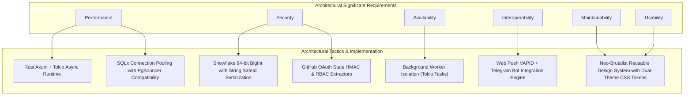

# Quality Attributes & Architectural Scenarios
## Sistem Manajemen Proyek Terintegrasi AI — OpenTask

**Pengembang / Penulis:** Evangelion Manuhutu (103022300164) & Tim Rekayasa Perangkat Lunak  
**Mata Kuliah:** Arsitektur Perangkat Lunak / Rekayasa Kebutuhan Perangkat Lunak  
**Program Studi:** S1 Rekayasa Perangkat Lunak, Fakultas Informatika, Universitas Telkom  
**Tanggal Update:** Oktober 2026  
**Repositori:** OpenTask (`opentask-app` & `opentask-api`)

---

## 1. Ringkasan Eksekutif Arsitektur

**OpenTask** adalah platform manajemen proyek modern berorientasi *Developer Experience* (DevX) dengan antarmuka *Neo-Brutalist* yang mengintegrasikan kecerdasan buatan (*Artificial Intelligence*) langsung ke dalam siklus hidup rekayasa perangkat lunak (*software development life cycle* / SDLC). OpenTask dirancang untuk menjawab tantangan fragmentasi alat kerja (*tool fragmentation*), penundaan *code review*, tugas yang terbengkalai (*stagnant tasks*), serta ketidakteraturan tindak lanjut rapat (*meeting action items*).

Arsitektur OpenTask dibangun di atas pondasi teknologi berkinerja tinggi (*high throughput & low latency*):
- **Frontend SPA**: React 19, TypeScript, Vite, Tailwind CSS v4, dikelola menggunakan runtime **Bun**. Mengusung antarmuka Neo-Brutalist dengan dukungan penuh dual-theme (*Dark & Light mode*).
- **Backend API Utama**: **Rust** (edisi 2024), memanfaatkan framework web **Axum 0.8**, *asynchronous runtime* **Tokio**, dan library ORM/database **SQLx** yang terhubung langsung ke **PostgreSQL**.
- **Backend API Layanan Khusus**: **Python 3.11+**, menggunakan **FastAPI** dan **Uvicorn** yang diorkestrasi menggunakan **UV** package manager.
- **Database & Penyimpanan**: **PostgreSQL 15+** (Supabase / Containerized PostgreSQL) dengan dukungan *connection pooling* tangguh dan aman terhadap *transaction poolers* (PgBouncer).
- **Integritas Identitas 64-bit**: Twitter-style 64-bit BigInt **Snowflake ID** dengan serialisasi string `SafeId` untuk mencegah *precision loss* numerik pada runtime JavaScript (IEEE-754 float64).
- **Layanan Eksternal Terintegrasi**: Google Gemini 2.5/3.6 Flash (AI Code Review & Meeting MoM Intelligence), GitHub App API & Webhooks, Recall.ai (Bot Rapat Otomatis), serta Web Push VAPID dan Telegram Bot API.

Sistem ini dirancang secara khusus untuk memenuhi serangkaian *Architecturally Significant Requirements* (ASR) yang mencakup: **Performance**, **Security**, **Availability**, **Maintainability**, **Interoperability**, **Scalability**, **Usability**, dan **Testability**.

---

## 2. Quality Attribute Priorities (Tingkat Prioritas ASR)

Penentuan prioritas atribut kualitas pada OpenTask dilakukan menggunakan pembobotan berbasis dampak risiko operasional, integritas data, dan ekspektasi pengguna di industri rekayasa perangkat lunak:

| No | Atribut Kualitas (Quality Attribute) | Prioritas | Justifikasi Arsitektural |
| :--- | :--- | :--- | :--- |
| 1 | **Performance** | **High** | Manajemen Kanban Board interaktif dan webhook GitHub memerlukan waktu respons sub-detik (*low latency*). Backend Rust (Axum + Tokio) memproses *payload* tanpa *overhead garbage collector*. |
| 2 | **Security** | **High** | Menangani kode sumber, webhook *signature verification*, kredensial OAuth GitHub, token AI, dan kunci API repositori. Memerlukan isolasi otorisasi tingkat proyek dan perlindungan CSRF/XSS. |
| 3 | **Availability** | **High** | Sinkronisasi PR dan webhook evaluasi AI harus selalu siap menerima event dari GitHub secara berkelanjutan tanpa *downtime* tak terencana. |
| 4 | **Interoperability** | **High** | Kompatibilitas tanpa hambatan dengan ekosistem eksternal: GitHub App Webhooks, Google Gemini REST API, Recall.ai, Telegram Bot API, dan browser Web Push (RFC 8291/8292). |
| 5 | **Maintainability** | **High** | Struktur kode modular: pemisahan layer *extractors*, *models*, *services*, dan *routes* di backend Rust, serta design system terstandarisasi di frontend (`src/design-system/`). |
| 6 | **Usability** | **Medium** | Desain Neo-Brutalist ergonomis dengan kontras visual tinggi, umpan balik interaktif, *drag-and-drop* lancar, dan keterbacaan konsisten pada mode terang (*light*) maupun gelap (*dark*). |
| 7 | **Scalability** | **Medium** | Model *stateless server* pada Axum memungkinkan ekspansi horizontal di belakang reverse proxy, didukung *connection pooling* efisien ke PostgreSQL. |
| 8 | **Testability** | **Medium** | Backend memiliki *integration tests* komprehensif (`cargo test`), dan frontend mendukung pengujian otomatis unit serta bundle verification (`bun run build`). |

---

## 3. Dukungan Teknologi terhadap ASR

### 3.1 Usability & Accessibility
- **Design System Mandiri (`src/design-system/`)**: Komponen atomik (`Button`, `CloseButton`, `SurfaceCard`, `Badge`, `TrashButton`, `Toast`, `Skeleton`, `ProgressBar`) memastikan konsistensi interaksi di seluruh alur kerja.
- **Dual Theme Integrity (Dark & Light Mode)**: CSS custom variables (`--cmd-app-bg`, `--cmd-surface`, `--cmd-text-body`, `--cmd-border`) dikombinasikan dengan audit kontras ketat memastikan rasio kontras teks minimal 4.5:1 (WCAG AA).
- **Optimistic UI & Reaktif**: Operasi drag-and-drop bucket dan kartu Kanban diperbarui langsung di memori frontend secara instan sebelum respons sinkronisasi backend selesai.

### 3.2 Security & Data Protection
- **Snowflake SafeId Pattern**: ID 64-bit diserialisasikan ke format string di tingkat Pydantic dan Serde Rust (`SafeId(i64)`), mencegah bug pembulatan data di JavaScript yang dapat merusak integritas referensial.
- **GitHub OAuth dengan HMAC State Verifier**: Autentikasi lintas origin menyimpan parameter `return_to` di dalam state terenkripsi/tervalidasi, mencegah serangan *CSRF login hijacking*.
- **Role-Based Access Control (RBAC)**: Validasi peran (`MANAGER`, `PROGRAMMER`, `DESIGNER`) di setiap endpoint manipulasi proyek dan repositori melalui custom Axum extractor.
- **API Key Masking & Enkripsi Kredensial**: Kunci API Google Gemini dan token GitHub disimpan aman dengan sistem *masking* otomatis pada logging dan respons antarmuka (`sk-***xxxx`).

### 3.3 Performance & Resource Efficiency
- **Rust + Tokio Asynchronous I/O**: Pemrosesan I/O non-blocking memungkinkan ribuan koneksi bersamaan dengan konsumsi memori footprint di bawah 30 MB pada keadaan *idle*.
- **PostgreSQL Connection Pool Optimization**: Konfigurasi SQLx pool (`min_connections: 2`, `max_connections: 20`, `statement_cache_capacity: 0`) memastikan interaksi database optimal tanpa benturan dengan *transaction poolers* (Supabase PgBouncer).
- **Frontend Zero-Overhead Bundle**: Dibangun dengan Vite 8 dan Tailwind CSS v4, meminimalkan ukuran file CSS/JS produksi di bawah 250 KB gzip.

### 3.4 Availability & Fault Tolerance
- **Asynchronous Task Workers**: Background worker untuk *Stagnation Radar* dan evaluasi AI PR dijalankan secara independen melalui Tokio tasks, sehingga kegagalan eksternal (misal rate-limit Gemini API) tidak memblokir API server utama.
- **Graceful Error Handling**: Model error terpadu (`AppError`) di Rust memetakan kegagalan jaringan atau query database ke respons HTTP yang informatif tanpa memicu *server panic* (*crash immunity*).
- **Stateless Cloud VPS & Containerization**: Dockerfile multi-stage berbasis Alpine/Debian-slim mempermudah *auto-restart* kontainer (`--restart unless-stopped`) di DewaCloud.

### 3.5 Interoperability & Integration
- **GitHub App Ecosystem**: Mendukung penerimaan dan pemrosesan otomatis webhook GitHub (event `pull_request`, `installation`).
- **Standardized Web Push (VAPID)**: Mengikuti standar IETF RFC 8291 dan RFC 8292 untuk pengiriman notifikasi langsung ke peramban tanpa perantara pihak ketiga tertutup.
- **Multi-Vendor AI Layer**: Integrasi fleksibel terhadap model Gemini (`gemini-2.5-flash`, `gemini-3.6-flash`) dengan mekanisme *fallback key* (Project Key $\rightarrow$ User Personal Key $\rightarrow$ Server Global Key).

### 3.6 Scalability & Maintainability
- **Clean Architecture & Separation of Concerns**: Pemisahan jelas antara layer *routes*, *services*, *extractors*, *models*, dan *db*.
- **Snowflake ID Generator Mandiri**: Tidak bergantung pada sequence auto-increment database pusat, memungkinkan *sharding* database di masa mendatang tanpa konflik *primary key*.

---

## 4. Quality Attribute Scenarios (Skenario Atribut Kualitas Formal)

Format skenario mengacu pada standar Software Engineering Institute (SEI) dengan 6 elemen: **Source of Stimulus**, **Stimulus**, **Artifact**, **Environment**, **Response**, dan **Response Measure**.

### Skenario 1: Performance — Pemuatan Kanban Board Berkapasitas Besar
- **Source**: Web Browser pengguna (Developer/Manager).
- **Stimulus**: Pengguna membuka halaman *Project Details* yang memiliki 5 *bucket* dan lebih dari 200 *tasks*.
- **Artifact**: Endpoint `GET /projects/{id}/board` dan komponen `ProjectDetails.tsx`.
- **Environment**: Kondisi beban normal hingga tinggi dengan koneksi jaringan 4G/Broadband.
- **Response**: Rust Axum mengeksekusi query relasional terindeks via SQLx, melakukan deserialisasi data ke JSON, dan frontend me-render komponen kartu Kanban tanpa terjadi pembekuan UI (*freeze*).
- **Response Measure**: Waktu respons API backend $\le 120\text{ ms}$; waktu *First Contentful Paint* (FCP) di browser $\le 450\text{ ms}$; frame rate animasi *drag-and-drop* stabil pada 60 FPS.

### Skenario 2: Performance & Scalability — Penanganan Webhook PR GitHub & Evaluasi AI
- **Source**: GitHub Webhook Server.
- **Stimulus**: Event `pull_request.opened` dikirimkan dengan *patch diff* kode sebesar 500 baris.
- **Artifact**: Service `pr_evaluator.rs`, `gemini.rs`, dan endpoint `/github/webhook`.
- **Environment**: Server backend sedang beroperasi normal dan melayani permintaan klien lain.
- **Response**: Server segera memvalidasi webhook payload, merespons `200 OK` ke GitHub dalam waktu singkat, lalu menjalankan evaluasi AI PR secara asinkron via Tokio background task, menganalisis kesesuaian tugas, menyimpan ulasan ke database, dan mengeposkan komentar ke PR.
- **Response Measure**: Respons awal ke GitHub dikembalikan dalam $\le 200\text{ ms}$; evaluasi lengkap AI beserta komentar di GitHub selesai dalam waktu $\le 8\text{ detik}$.

### Skenario 3: Security — Perlindungan Akses Data Proyek (RBAC) & SafeId Serialization
- **Source**: Klien eksternal yang tidak memiliki otorisasi (Percobaan *Insecure Direct Object Reference* / IDOR).
- **Stimulus**: Mengirimkan request `PUT /tasks/{task_id}` menggunakan ID tugas milik organisasi/proyek lain dengan SafeId 64-bit yang valid.
- **Artifact**: Extractor `ProjectKeyAuth`, route `tasks.rs`, dan layer database.
- **Environment**: Sistem beroperasi normal, terpapar di internet publik.
- **Response**: Middleware/Extractor memvalidasi hak akses token bearer pengguna terhadap proyek pemilik tugas; jika tidak berhak, permintaan ditolak dan log audit dicatat.
- **Response Measure**: Akses ditolak dengan status HTTP `403 Forbidden` dalam waktu $\le 25\text{ ms}$; tidak ada kebocoran data (*data leakage*); SafeId 64-bit tidak mengalami pemotongan bit (*zero precision loss*).

### Skenario 4: Security — Sanitasi dan Isolasi Kunci API AI
- **Source**: Pengguna pengguna tingkat proyek atau penyerang yang mencoba melakukan *prompt injection* atau ekstraksi API Key.
- **Stimulus**: Meminta data detail proyek melalui API atau mengirim transkrip rapat berbahaya.
- **Artifact**: Model `DatabaseProject` (`#[serde(skip_serializing)]`), service `gemini.rs`.
- **Environment**: Sistem beroperasi normal dalam multi-tenant project environment.
- **Response**: Kunci API AI (`custom_ai_api_key`) tidak pernah disertakan dalam payload serialisasi JSON ke klien publik; sistem menerapkan *masking* (`sk-***xxxx`) pada panel pengaturan.
- **Response Measure**: 100% kunci API aman dari kebocoran payload; percobaan eksfiltrasi menghasilkan data ter-masking.

### Skenario 5: Availability — Kegagalan Koneksi Database & Recovery Pool
- **Source**: Infrastruktur PostgreSQL eksternal (Supabase) mengalami restrukturisasi koneksi mendadak / network blip.
- **Stimulus**: Pool koneksi kehilangan koneksi aktif secara tiba-tiba saat query berlangsung.
- **Artifact**: Modul database `src/db/mod.rs` (`sqlx::PgPool`).
- **Environment**: Jam operasional sibuk, terjadi pemutusan koneksi selama 3 detik.
- **Response**: Driver SQLx mendeteksi koneksi *stale*, mengisolasi error ke request terkait, dan secara otomatis melakukan *reconnection* ke database tanpa perlu me-restart proses aplikasi (*graceful reconnection*).
- **Response Measure**: Waktu pemulihan koneksi pool otomatis $\le 2\text{ detik}$; ketersediaan sistem (*availability uptime*) tahunan tetap berada pada level $\ge 99.9\%$.

### Skenario 6: Interoperability — Multi-Channel Dispatch Alert (Web Push & Telegram)
- **Source**: Pekerja Latar Belakang *Stagnation Radar* (`stagnation.rs`).
- **Stimulus**: Tugas terdeteksi tidak memiliki aktivitas pengembangan (*commit/PR*) selama lebih dari 48 jam.
- **Artifact**: Service `notifications.rs`, `telegram.rs`, dan push endpoint VAPID.
- **Environment**: Developer tidak sedang aktif membuka tab web browser OpenTask.
- **Response**: Sistem secara serentak memformat pesan peringatan, menandai tugas untuk saran realokasi kepada Project Manager, mengirim pesan peringatan via Telegram Bot, serta mendistribusikan notifikasi Web Push ke perangkat terdaftar.
- **Response Measure**: Notifikasi Web Push dan Telegram berhasil diterima oleh klien dalam waktu $\le 3\text{ detik}$ setelah radar mendeteksi stagnasi; tingkat keberhasilan pengiriman (*delivery rate*) $\ge 98\%$.

### Skenario 7: Maintainability — Penambahan Fitur Baru pada Design System & Model Data
- **Source**: Software Architect / Pengembang OpenTask.
- **Stimulus**: Penambahan tipe status baru pada Kanban Bucket atau field baru pada Task.
- **Artifact**: Direktori frontend `src/design-system/`, model Rust `DatabaseTask`, dan migrasi SQLx.
- **Environment**: Siklus pemeliharaan kode dan sprint pengembangan berkala.
- **Response**: Struktur TypeScript yang ketat dan Rust compile-time type-safety memverifikasi kesesuaian tipe di seluruh aplikasi saat build time.
- **Response Measure**: Waktu kompilasi penuh backend (`cargo check`) $\le 15\text{ detik}$; build frontend (`bun run build`) $\le 5\text{ detik}$; tidak ada *regression runtime error* berkat validasi statis.

### Skenario 8: Usability — Keterbacaan Kontras Tema Ganda (Light/Dark Mode Switch)
- **Source**: Pengguna akhir yang mengganti preferensi tampilan sistem di peramban.
- **Stimulus**: Beralih dari mode gelap (*Dark*) ke mode terang (*Light*) di tengah navigasi aktif.
- **Artifact**: `ThemeContext.tsx`, `index.css`, seluruh komponen `src/design-system/`.
- **Environment**: Kondisi pencahayaan ruangan tinggi (siang hari), pengguna membutuhkan kontras tajam.
- **Response**: Variabel CSS berubah secara instan tanpa me-reload halaman; seluruh teks judul, kartu Kanban, status badge, dan border mempertahankan kontras tajam tanpa artefak teks putih di atas latar putih.
- **Response Measure**: Transisi tema selesai dalam $\le 50\text{ ms}$; nilai kontras teks terhadap latar belakang memenuhi standar WCAG 2.1 AA ($\ge 4.5:1$).

---

## 5. Ringkasan Matriks ASR & Taktik Arsitektur

---

## 6. Daftar Referensi

1. **Bass, L., Clements, P., & Kazman, R.** (2021). *Software Architecture in Practice (4th Edition)*. Addison-Wesley Professional.
2. **Axum Framework Documentation**: https://docs.rs/axum/latest/axum/
3. **Tokio Asynchronous Runtime for Rust**: https://tokio.rs/tokio/tutorial
4. **SQLx Toolkit Documentation**: https://docs.rs/sqlx/latest/sqlx/
5. **React 19 Official Documentation**: https://react.dev/
6. **Tailwind CSS v4 Specification**: https://tailwindcss.com/docs
7. **Google Gemini API Reference**: https://ai.google.dev/api/rest
8. **GitHub REST API & Webhooks Documentation**: https://docs.github.com/en/rest
9. **RFC 8291 (Message Encryption for Web Push) & RFC 8292 (VAPID)**: https://datatracker.ietf.org/doc/html/rfc8292
10. **Web Content Accessibility Guidelines (WCAG) 2.1**: https://www.w3.org/TR/WCAG21/
