# Architecture Quality Attribute Tree (Utility Tree)
## Sistem Manajemen Proyek Terintegrasi AI — OpenTask

**Pengembang / Penulis:** Evangelion Manuhutu (103022300164) & Tim Rekayasa Perangkat Lunak  
**Mata Kuliah:** Arsitektur Perangkat Lunak / Rekayasa Kebutuhan Perangkat Lunak  
**Program Studi:** S1 Rekayasa Perangkat Lunak, Fakultas Informatika, Universitas Telkom  
**Standar Metodologi:** SEI (Software Engineering Institute) — Architecture Tradeoff Analysis Method (ATAM) & Attribute-Driven Design (ADD)  
**Dokumen Induk:** [`QUALITY_ATTRIBUTES.md`](file:///d:/Dev/OpenTask/docs/QUALITY_ATTRIBUTES.md) & [`DOKUMEN_QUALITY_ATTRIBUTES_FORMAL.md`](file:///d:/Dev/OpenTask/docs/DOKUMEN_QUALITY_ATTRIBUTES_FORMAL.md)  
**Tanggal Rilis:** November 2026  

---

## 1. Pengantar & Konsep Quality Attribute Tree

Dalam rekayasa arsitektur perangkat lunak berbasis standar *Software Engineering Institute* (SEI) (*Bass, Clements, & Kazman, 2021*), **Quality Attribute Tree** (atau **Utility Tree**) merupakan instrumen utama untuk menerjemahkan sasaran kualitas tingkat tinggi sistem (*high-level business goals*) menjadi skenario arsitektural konkret (*architectural scenarios*) yang terukur dan dapat diuji.

```
+-----------------------------------------------------------------------------------+
|                                  UTILITY TREE                                     |
|                                                                                   |
|  [Root: Utility]                                                                  |
|         │                                                                         |
|         ├── [Level 1: Quality Attribute] (e.g., Performance, Security)            |
|         │         │                                                               |
|         │         └── [Level 2: Sub-Attribute / Refinement] (e.g., Latency)       |
|         │                   │                                                     |
|         │                   └── [Level 3: Concrete Scenario (Leaf)] (QA-XX)       |
|         │                             └── Ranking Prioritas: (Bisnis, Teknis)     |
+-----------------------------------------------------------------------------------+
```

### 1.1 Struktur Hierarki 4 Tingkat
Pohon Utilitas OpenTask dibangun dalam empat lapisan hierarki:
1. **Root (Utility)**: Representasi kegunaan, keandalan, dan kebaikan arsitektural menyeluruh sistem OpenTask.
2. **Quality Attribute (Kategori Utama)**: Karakteristik mutu sistem yang diturunkan dari *Architecturally Significant Requirements* (ASR), meliputi: *Performance*, *Security*, *Availability*, *Interoperability*, *Maintainability*, *Usability*, *Scalability*, dan *Testability*.
3. **Attribute Refinement (Aspek Kualitas)**: Dekomposisi atribut kualitas menjadi aspek operasional yang lebih spesifik (misal: *Latency*, *Throughput*, *Access Control*, *Fault Tolerance*, *Visual Contrast*).
4. **Concrete Architectural Scenario (Daun Pohon / Leaf Node)**: Skenario operasional spesifik yang dilengkapi stimulus, respons terukur (*response measure*), serta pembobotan prioritas.

### 1.2 Skema Penentuan Prioritas ATAM (Prioritization Tuple)
Setiap daun skenario dibobot menggunakan pasangan tuple `(Kepentingan Bisnis, Kesulitan Arsitektural)`:
- **Parameter 1: Tingkat Kepentingan bagi Bisnis & Pemangku Kepentingan (Importance to Stakeholders / Business)**
  - **High (H)**: Fitur inti operasional; kegagalan akan langsung melumpuhkan bisnis atau membocorkan data sensitif.
  - **Medium (M)**: Fitur penting untuk kenyamanan dan efisiensi alur kerja pengembang.
  - **Low (L)**: Fitur penunjang yang tidak berdampak langsung pada kelangsungan transaksi utama.
- **Parameter 2: Tingkat Risiko dan Kompleksitas Desain Teknis (Architectural Risk / Technical Difficulty)**
  - **High (H)**: Menuntut taktik arsitektur canggih, sinkronisasi asinkron non-blocking, mitigasi *race condition*, atau integrasi multi-layanan eksternal.
  - **Medium (M)**: Membutuhkan pola arsitektur terstandarisasi (misal: middleware RBAC, connection pool, token CSS).
  - **Low (L)**: Implementasi langsung menggunakan pustaka atau konvensi kode standar.

| Kategori Prioritas | Interpretasi Arsitektur | Fokus Alokasi Desain & Evaluasi |
| :---: | :--- | :--- |
| **(H, H)** | **Kritis (Critical Focus)** | Memerlukan perhatian perancangan tertinggi, prototipe dini, dan pengujian beban ketat. |
| **(H, M)** | **Tinggi (High Priority)** | Memerlukan taktik mitigasi teruji dan pemantauan aktif pada siklus rilis. |
| **(M, M)** | **Moderat (Medium Priority)** | Mengikuti panduan desain arsitektural baku tanpa variasi kompleks. |
| **(M, L) / (L, L)**| **Standar / Rendah (Low Priority)** | Cukup diverifikasi melalui pemeriksaan rutin dan linter statis. |

---

## 2. Visualisasi Pohon Utilitas Kualitas (Mermaid Diagram)

Diagram berikut merepresentasikan hierarki lengkap **Quality Attribute Tree** untuk platform OpenTask:

```mermaid
graph LR
    %% Root
    Root["UTILITY (OpenTask): Evaluasi Arsitektural Menyeluruh"]

    %% Level 1: Quality Attributes
    Root --> QA_P["1. Performance (Prioritas: High)"]
    Root --> QA_S["2. Security (Prioritas: High)"]
    Root --> QA_A["3. Availability (Prioritas: High)"]
    Root --> QA_I["4. Interoperability (Prioritas: High)"]
    Root --> QA_M["5. Maintainability (Prioritas: High)"]
    Root --> QA_U["6. Usability (Prioritas: Medium)"]
    Root --> QA_SC["7. Scalability (Prioritas: Medium)"]
    Root --> QA_T["8. Testability (Prioritas: Medium)"]

    %% Level 2: Performance Refinements
    QA_P --> P_Lat["Response Latency"]
    QA_P --> P_Thr["Processing Throughput"]
    P_Lat --> SC_P1["QA-P1: Pemuatan Board Kanban (API <= 120ms, FCP <= 450ms) [H, H]"]
    P_Thr --> SC_P2["QA-P2: Evaluasi AI pada Webhook PR (Handshake <= 200ms, Review <= 8s) [H, H]"]

    %% Level 2: Security Refinements
    QA_S --> S_Acc["Access Control & Auth"]
    QA_S --> S_Int["Numeric & Format Integrity"]
    QA_S --> S_Conf["Credential Confidentiality"]
    S_Acc --> SC_S1["QA-S1: Proteksi RBAC & Anti-IDOR (403 Forbidden <= 25ms) [H, H]"]
    S_Int --> SC_S2["QA-S2: Integritas SafeId 64-bit (Zero Precision Loss) [H, M]"]
    S_Conf --> SC_S3["QA-S3: Isolasi Kunci API AI & Token (sk-***xxxx) [H, H]"]

    %% Level 2: Availability Refinements
    QA_A --> A_Rec["Fault Recovery & Self-Healing"]
    QA_A --> A_Iso["Subsystem Failure Isolation"]
    A_Rec --> SC_A1["QA-A1: Auto-Recovery Pool Basis Data (Reconnection <= 2s) [H, M]"]
    A_Iso --> SC_A2["QA-A2: Isolasi Crash Pekerja Latar AI (No Server Panic) [H, M]"]

    %% Level 2: Interoperability Refinements
    QA_I --> I_Web["Webhook Ingestion Engine"]
    QA_I --> I_Push["Multi-Channel Dispatch"]
    I_Web --> SC_I1["QA-I1: Sinkronisasi GitHub App (Validasi HMAC & Auto-Link) [H, M]"]
    I_Push --> SC_I2["QA-I2: Distribusi Alert VAPID & Telegram (Latensi <= 3s) [H, M]"]

    %% Level 2: Maintainability Refinements
    QA_M --> M_Mod["Separation of Concerns"]
    QA_M --> M_Type["Compile-Time Type Safety"]
    M_Mod --> SC_M1["QA-M1: Modular Design System (Zero UI Redundancy) [H, M]"]
    M_Type --> SC_M2["QA-M2: Integritas Kontrak Data Statis (Cargo Check <= 15s) [H, M]"]

    %% Level 2: Usability Refinements
    QA_U --> U_Cont["Visual Accessibility & Contrast"]
    QA_U --> U_Dyn["Interactive Responsiveness"]
    U_Cont --> SC_U1["QA-U1: Aksesibilitas Tema Ganda (WCAG AA >= 4.5:1) [M, M]"]
    U_Dyn --> SC_U2["QA-U2: Optimistic Kanban Drag & Drop (60 FPS) [M, M]"]

    %% Level 2: Scalability Refinements
    QA_SC --> SC_Stat["Stateless Horizontal Scaling"]
    QA_SC --> SC_Pool["Database Pool Efficiency"]
    SC_Stat --> SC_SC1["QA-SC1: Replikasi Stateless Axum (Cold Start <= 1s) [M, M]"]
    SC_Pool --> SC_SC2["QA-SC2: Kompatibilitas PgBouncer (2-20 Conn Bound) [M, M]"]

    %% Level 2: Testability Refinements
    QA_T --> T_Auto["Automated Integration Testing"]
    QA_T --> T_Bun["Bundle & Type Verification"]
    T_Auto --> SC_T1["QA-T1: Integration Test Backend (Cargo Test 100% Pass) [M, L]"]
    T_Bun --> SC_T2["QA-T2: Verifikasi Bundle Frontend (Bun Build <= 5s) [M, L]"]

    %% Styling Nodes
    classDef rootStyle fill:#FFE600,stroke:#000000,stroke-width:3px,color:#000000,font-weight:bold;
    classDef highQA fill:#000000,stroke:#FFE600,stroke-width:2px,color:#FFE600,font-weight:bold;
    classDef medQA fill:#1E293B,stroke:#94A3B8,stroke-width:2px,color:#FFFFFF,font-weight:bold;
    classDef refStyle fill:#F1F5F9,stroke:#000000,stroke-width:1.5px,color:#000000;
    classDef hhStyle fill:#FF3333,stroke:#000000,stroke-width:2px,color:#FFFFFF,font-weight:bold;
    classDef hmStyle fill:#FF9900,stroke:#000000,stroke-width:2px,color:#000000,font-weight:bold;
    classDef mmStyle fill:#00FF66,stroke:#000000,stroke-width:2px,color:#000000,font-weight:bold;
    classDef mlStyle fill:#E2E8F0,stroke:#475569,stroke-width:1.5px,color:#0F172A;

    class Root rootStyle;
    class QA_P,QA_S,QA_A,QA_I,QA_M highQA;
    class QA_U,QA_SC,QA_T medQA;
    class P_Lat,P_Thr,S_Acc,S_Int,S_Conf,A_Rec,A_Iso,I_Web,I_Push,M_Mod,M_Type,U_Cont,U_Dyn,SC_Stat,SC_Pool,T_Auto,T_Bun refStyle;
    class SC_P1,SC_P2,SC_S1,SC_S3 hhStyle;
    class SC_S2,SC_A1,SC_A2,SC_I1,SC_I2,SC_M1,SC_M2 hmStyle;
    class SC_U1,SC_U2,SC_SC1,SC_SC2 mmStyle;
    class SC_T1,SC_T2 mlStyle;

    class Root rootStyle;
    class QA_P,QA_S,QA_A,QA_I,QA_M highQA;
    class QA_U,QA_SC,QA_T medQA;
    class P_Lat,P_Thr,S_Acc,S_Int,S_Conf,A_Rec,A_Iso,I_Web,I_Push,M_Mod,M_Type,U_Cont,U_Dyn,SC_Stat,SC_Pool,T_Auto,T_Bun refStyle;
    class SC_P1,SC_P2,SC_S1,SC_S3 hhStyle;
    class SC_S2,SC_A1,SC_A2,SC_I1,SC_I2,SC_M1,SC_M2 hmStyle;
    class SC_U1,SC_U2,SC_SC1,SC_SC2 mmStyle;
    class SC_T1,SC_T2 mlStyle;
```



---

## 3. Matriks Spesifikasi Detail Quality Attribute Tree

Tabel berikut memetakan setiap simpul daun (*leaf scenario*) pada Quality Attribute Tree dengan parameter operasional, ukuran respons (*response measure*), prioritas ATAM, serta taktik arsitektural yang diterapkan:

| ID Skenario | Atribut Kualitas | Sub-Atribut (Refinement) | Stimulus & Alur Respons Sistem | Ukuran Respons (*Response Measure*) | Prioritas ATAM (Bisnis, Teknis) | Taktik Arsitektur OpenTask Terkait |
| :--- | :--- | :--- | :--- | :--- | :---: | :--- |
| **QA-P1** | **Performance** | Response Latency | Pengguna membuka board proyek dengan 5 bucket dan $>200$ tasks aktif secara serentak. | - Waktu respons API backend $\le 120\text{ ms}$<br>- Pemuatan awal *First Contentful Paint* (FCP) $\le 450\text{ ms}$<br>- Animasi drag-and-drop stabil pada $60\text{ FPS}$ | **(H, H)** | - Rust Axum + Tokio Non-blocking I/O<br>- Indeks komposit SQLx PostgreSQL<br>- Virtualisasi state UI |
| **QA-P2** | **Performance** | Processing Throughput | Event webhook GitHub `pull_request.opened` diterima dengan patch diff hingga 500 baris. | - Handshake awal webhook $\le 200\text{ ms}$<br>- Evaluasi AI dan publikasi komentar PR $\le 8\text{ detik}$ | **(H, H)** | - Asynchronous Tokio Background Task<br>- Decoupled Webhook Handler<br>- Zero-copy JSON serde parsing |
| **QA-S1** | **Security** | Access Control & Auth | Percobaan IDOR dengan mengirimkan `PUT /tasks/{id}` menggunakan SafeId sah dari proyek organisasi lain. | - Permintaan ditolak dengan status HTTP `403 Forbidden`<br>- Waktu pemrosesan penolakan $\le 25\text{ ms}$<br>- Log audit keamanan tercatat | **(H, H)** | - Axum Custom Extractor (`ProjectKeyAuth`)<br>- Multi-tenant project boundary checking<br>- Role-Based Access Control (RBAC) |
| **QA-S2** | **Security** | Numeric & Format Integrity | Pengiriman ID Snowflake 64-bit BigInt ke runtime JavaScript peramban. | - Toleransi pembulatan $0\%$ (*zero precision loss*)<br>- Integritas kunci primer dan referensial $100\%$ | **(H, M)** | - Tipe data khusus `SafeId(i64)`<br>- Serialisasi string otomatis di Serde Rust & Pydantic<br>- Larangan parsing numerik di frontend |
| **QA-S3** | **Security** | Credential Confidentiality | Klien memanggil endpoint rincian proyek atau terjadi permintaan inspeksi konfigurasi. | - $100\%$ kunci API Gemini & GitHub terlindungi<br>- Tampilan di frontend tersamar (`sk-***xxxx`)<br>- Tidak bocor pada serialisasi JSON | **(H, H)** | - Serde directive `#[serde(skip_serializing)]`<br>- Secret Masking Engine<br>- Isolasi kredensial per proyek |
| **QA-A1** | **Availability** | Fault Recovery & Healing | Klaster PostgreSQL awan (Supabase) mengalami pemutusan koneksi sementara (*network blip* selama 3 detik). | - Pemulihan kolam koneksi otomatis $\le 2\text{ detik}$<br>- Ketersediaan layanan (*uptime*) tahunan $\ge 99.9\%$ | **(H, M)** | - SQLx Connection Pool Reconnection Logic<br>- Stateful Ping / Health Probe<br>- Non-panicking `AppError` mapping |
| **QA-A2** | **Availability** | Subsystem Isolation | Layanan pihak ketiga (Google Gemini API) mengalami *rate limiting* (HTTP 429) atau gangguan jaringan. | - Kegagalan AI tidak mematikan server utama ($0\text{ server panic}$)<br>- Layanan Kanban Board tetap beroperasi normal $100\%$ | **(H, M)** | - Worker Decoupling via Tokio Spawning<br>- Graceful Error Containment<br>- Fallback API Key Multi-Tingkat |
| **QA-I1** | **Interoperability** | Webhook Ingestion Engine | Repositori GitHub mengirimkan rentetan webhook untuk siklus hidup PR dan instalasi bot. | - Validasi HMAC signature payload $100\%$ akurat<br>- Pemetaan commit ke tiket Kanban otomatis | **(H, M)** | - GitHub App Integration Engine<br>- GitHub Webhook HMAC SHA-256 Verifier<br>- Idempotent event processing |
| **QA-I2** | **Interoperability** | Multi-Channel Dispatch | *Stagnation Radar* mendeteksi tugas terbengkalai $>48$ jam tanpa aktivitas pengembang. | - Pengiriman Web Push & Telegram $\le 3\text{ detik}$<br>- Tingkat keberhasilan transmisi (*delivery rate*) $\ge 98\%$ | **(H, M)** | - Protokol IETF RFC 8291/8292 (VAPID)<br>- Telegram Bot API Asynchronous Client<br>- Batch notification queue |
| **QA-M1** | **Maintainability** | Separation of Concerns | Penambahan varian komponen visual atau pembaruan alur status tiket. | - Eliminasi duplikasi kode antarmuka ($0$ redundansi CSS)<br>- Perubahan lokal terisolasi pada satu berkas | **(H, M)** | - Reusable Design System (`src/design-system/`)<br>- Clean Architecture (Route, Service, Model, DB)<br>- Standarisasi Token CSS |
| **QA-M2** | **Maintainability** | Static Type Safety | Modifikasi skema basis data atau penambahan kolom baru pada entitas tugas. | - Waktu kompilasi `cargo check` $\le 15\text{ detik}$<br>- Waktu kompilasi frontend `bun run build` $\le 5\text{ detik}$<br>- Zero runtime type error pasca-rilis | **(H, M)** | - Rust Compile-time Static Type Enforcement<br>- TypeScript strict mode di frontend<br>- Kompatibilitas skema SQLx migrasi |
| **QA-U1** | **Usability** | Visual Accessibility | Pengguna beralih antara Dark Mode dan Light Mode pada ruangan dengan pencahayaan terang. | - Waktu propagasi pergantian tema $\le 50\text{ ms}$<br>- Rasio kontras teks memenuhi WCAG 2.1 AA ($\ge 4.5:1$) | **(M, M)** | - Dynamic CSS Custom Properties (`--cmd-border`, dll)<br>- Zero-blur High-Contrast Neo-Brutalist Geometry<br>- ThemeContext reactive switching |
| **QA-U2** | **Usability** | Interactive Responsiveness | Pemindahan kartu tugas antar-kolom Kanban melalui gestur *drag-and-drop*. | - Perubahan posisi di layar seketika ($0\text{ ms perceived lag}$)<br>- Sinkronisasi persistensi di latar belakang sukses $100\%$ | **(M, M)** | - Optimistic UI State Management<br>- Reaktif state lokal sebelum konfirmasi HTTP<br>- Auto-rollback jika request backend gagal |
| **QA-SC1**| **Scalability** | Stateless Horizontal Scaling| Lonjakan lalu lintas pengguna meningkat 5 kali lipat pada jam kerja sibuk. | - Penambahan instans pod server baru tanpa rekonfigurasi state sesi<br>- Waktu *cold start* pod baru $\le 1\text{ detik}$ | **(M, M)** | - Stateless REST API Architecture<br>- Token-based Bearer Authentication<br>- Containerized Docker Alpine / Debian-slim |
| **QA-SC2**| **Scalability** | Database Pool Efficiency | Ratusan koneksi konkuren mengakses basis data melalui perantara PgBouncer Supabase. | - Tidak ada kebuntuan koneksi (*zero connection leak*)<br>- Konsumsi memori per koneksi optimal | **(M, M)** | - SQLx Pool Configuration (`statement_cache_capacity: 0`)<br>- Lease & Return `finally` block discipline<br>- Pool size bounded (min: 2, max: 20) |
| **QA-T1** | **Testability** | Automated Integration Testing | Eksekusi seluruh rangkaian *integration test* pada pipeline integrasi berkelanjutan (CI). | - Seluruh pengujian endpoint dan logika AI tuntas dalam waktu $\le 60\text{ detik}$ dengan kelulusan $100\%$ | **(M, L)** | - Rust Test Harness (`cargo test`)<br>- Mocking service layer untuk AI & GitHub<br>- Isolated testing database instance |
| **QA-T2** | **Testability** | Bundle & Type Verification | Eksekusi verifikasi statis dan *production bundle build* pada antarmuka web. | - Eksekusi `bun run build` tuntas $\le 5\text{ detik}$<br>- Ukuran aset produksi terkompresi $< 250\text{ KB}$ | **(M, L)** | - Bun Bundler & Package Execution Engine<br>- Tree-shaking Tailwind CSS v4 & Vite 8<br>- Static TypeScript linter check |

---

## 4. Analisis Mendalam Per Cabang Kualitas (Branch Breakdown)

### 4.1 Cabang Kinerja (Performance Branch)
*Fokus: Meminimalkan latensi pemrosesan dan memaksimalkan kapasitas olah (throughput).*

```
Performance
  ├── Response Latency ──> [QA-P1] Pemuatan Board Kanban Skala Besar (H, H)
  └── Processing Throughput ──> [QA-P2] Penanganan Webhook PR & Evaluasi AI (H, H)
```

- **Rasionalisasi Prioritas (H, H)**: 
  OpenTask adalah sarana kerja harian pengembang perangkat lunak. Pembekuan antarmuka pada papan Kanban berisi ratusan tugas akan merusak pengalaman pengguna (*Developer Experience* / DevX). Di sisi lain, batas waktu *timeout* webhook GitHub sangat ketat (maksimal 10 detik). Kegagalan merespons dalam jendela waktu tersebut akan menyebabkan GitHub menghentikan pengiriman webhook lanjutan.
- **Taktik Implementasi**:
  1. *Resource Demand Management*: Handler webhook Axum memisahkan respons HTTP dari evaluasi berat. Respons `200 OK` segera dikirim ke GitHub ($\le 200\text{ ms}$), sementara beban komputasi AI dialokasikan ke pekerja latar belakang (*Tokio worker pool*).
  2. *Compile-time Optimization*: Backend Rust tidak memiliki *runtime garbage collector*, sehingga menghindari jeda *stop-the-world* yang kerap terjadi pada platform berbasis managed runtime.

---

### 4.2 Cabang Keamanan (Security Branch)
*Fokus: Menjaga kerahasiaan data, integritas identitas objek, dan pencegahan eskalasi hak akses.*

```
Security
  ├── Access Control & Auth ──> [QA-S1] Proteksi Akses Data Proyek & Anti-IDOR (H, H)
  ├── Numeric & Format Integrity ──> [QA-S2] Integritas SafeId 64-bit (H, M)
  └── Credential Confidentiality ──> [QA-S3] Sanitasi & Isolasi Kunci API AI (H, H)
```

- **Rasionalisasi Prioritas**:
  - **QA-S1 (H, H)**: Pelanggaran batas proyek (*cross-tenant leakage*) berpotensi membocorkan kode sumber rahasia dan rencana strategis organisasi kepada pihak luar.
  - **QA-S2 (H, M)**: Angka 64-bit BigInt (Snowflake ID) melampaui `Number.MAX_SAFE_INTEGER` ($2^{53}-1$) pada peramban. Tanpa mitigasi, ID akan dibulatkan secara acak di JavaScript, menyebabkan modifikasi data salah sasaran (*data corruption*).
  - **QA-S3 (H, H)**: Kunci API Google Gemini dan token GitHub App memiliki nilai ekonomis dan hak akses tinggi. Eksfiltrasi kunci dapat menyebabkan pembengkakan tagihan atau manipulasi repositori.
- **Taktik Implementasi**:
  1. *Restrict Access via Extractor*: Custom Axum Extractor memeriksa kepemilikan token pengguna terhadap ID proyek pada setiap panggilan termutasi.
  2. *Data Integrity Enforcement*: Format string `SafeId` membungkus representasi numerik 64-bit di tingkat serialisasi, menjamin transmisi aman menuju klien.
  3. *Information Hiding*: Menggunakan atribut Serde `#[serde(skip_serializing)]` pada model entitas dan filter masking `sk-***xxxx` pada panel konfigurasi.

---

### 4.3 Cabang Ketersediaan (Availability Branch)
*Fokus: Menjamin keandalan operasional berkelanjutan dan isolasi kegagalan subsistem.*

```
Availability
  ├── Fault Recovery & Self-Healing ──> [QA-A1] Auto-Recovery Pool Basis Data (H, M)
  └── Subsystem Failure Isolation ──> [QA-A2] Isolasi Crash Pekerja Latar AI (H, M)
```

- **Rasionalisasi Prioritas (H, M)**:
  Layanan awan modern seperti Supabase PgBouncer secara berkala menyegarkan koneksi atau memutus koneksi menganggur (*idle timeout*). Arsitektur OpenTask harus mampu memulihkan diri secara otomatis tanpa memerlukan intervensi manual atau *restart* server.
- **Taktik Implementasi**:
  1. *Active Health Probing & Auto-Reconnection*: Modul `sqlx::PgPool` dikonfigurasi dengan pemeriksaan koneksi berkala sehingga koneksi yang putus langsung dieliminasi dan dibentuk kembali secara transparan.
  2. *Fault Decoupling*: Pemanggilan API Gemini dijalankan dalam isolasi `tokio::spawn`. Kesalahan parsing atau respons HTTP 5xx/429 dari pihak eksternal hanya berdampak lokal pada ulasan yang bersangkutan, tanpa melumpuhkan router Axum.

---

### 4.4 Cabang Interoperabilitas (Interoperability Branch)
*Fokus: Menjalin komunikasi data yang mulus dengan ekosistem pihak ketiga berbasis standar terbuka.*

```
Interoperability
  ├── Webhook Ingestion Engine ──> [QA-I1] Pemrosesan Event GitHub App (H, M)
  └── Multi-Channel Dispatch ──> [QA-I2] Distribusi Peringatan VAPID & Telegram (H, M)
```

- **Rasionalisasi Prioritas (H, M)**:
  Daya saing utama OpenTask terletak pada otomatisasi alur kerja antara repositori GitHub, peringatan tugas mandek (*Stagnation Radar*), dan bot notifikasi.
- **Taktik Implementasi**:
  1. *Open Standards Compliance*: Mengimplementasikan enkripsi Web Push standar IETF RFC 8291 dan RFC 8292 (VAPID) untuk menjamin kompatibilitas langsung dengan Chrome, Firefox, Safari, dan Edge tanpa ketergantungan pada pustaka proprietary.
  2. *Cryptographic Verification*: Memvalidasi header `X-Hub-Signature-256` pada setiap muatan data yang masuk dari GitHub sebelum diteruskan ke mesin pemroses internal.

---

### 4.5 Cabang Kemudahan Pemeliharaan (Maintainability Branch)
*Fokus: Struktur kode modular yang mempermudah evolusi fitur dan validasi tipe sebelum runtime.*

```
Maintainability
  ├── Separation of Concerns ──> [QA-M1] Desain Sistem Terstandarisasi (H, M)
  └── Compile-Time Type Safety ──> [QA-M2] Integritas Kontrak Data Statis (H, M)
```

- **Rasionalisasi Prioritas (H, M)**:
  Basis kode yang menggabungkan backend berperforma tinggi (Rust/Python) dan frontend kaya interaksi (React 19) rentan mengalami ketidakkonsistenan kontrak data saat dikembangkan secara kolaboratif.
- **Taktik Implementasi**:
  1. *Component-Driven Reuse*: Seluruh elemen antarmuka wajib mengimpor komponen atomik dari `src/design-system/` (`Button`, `CloseButton`, `SurfaceCard`, `Badge`, `TrashButton`, `Toast`, `Skeleton`, `ProgressBar`), mencegah fragmentasi styling.
  2. *Static Contract Verification*: Menjaga keselarasan struktur data antara model `DatabaseTask` di Rust dengan tipe TypeScript di frontend, meminimalkan bug *null-pointer* atau ketidakcocokan atribut.

---

### 4.6 Cabang Kegunaan (Usability Branch)
*Fokus: Ergonomi visual, aksesibilitas tinggi, dan pengalaman interaksi tanpa jeda.*

```
Usability
  ├── Visual Accessibility & Contrast ──> [QA-U1] Aksesibilitas Kontras Tema Ganda (M, M)
  └── Interactive Responsiveness ──> [QA-U2] Pembaruan Optimistik Kanban (M, M)
```

- **Rasionalisasi Prioritas (M, M)**:
  Desain bertema Neo-Brutalist mengandalkan kontras ekstrem dan batas garis tebal. Diperlukan penjaminan teknis agar peralihan ke mode terang tidak menghasilkan teks putih di atas latar putih (*unreadable contrast bug*).
- **Taktik Implementasi**:
  1. *Centralized Token CSS*: Pemetaan variabel warna terpadu di `src/index.css` (`--cmd-app-bg`, `--cmd-surface`, `--cmd-text-body`, `--cmd-border`) memastikan rasio kontras teks selalu melampaui ambang batas $4.5:1$ (standar WCAG 2.1 AA).
  2. *Optimistic UI State Updating*: Posisi kartu tugas pada DOM diperbarui seketika saat dijatuhkan pengguna, sementara sinkronisasi HTTP `PATCH` berjalan asinkron di latar belakang dengan mekanisme rollback jika gagal.

---

### 4.7 Cabang Skalabilitas & Pengujian (Scalability & Testability Branches)
*Fokus: Ekspansi kapasitas horizontal dan otomasi verifikasi perangkat lunak.*

```
Scalability
  ├── Stateless Horizontal Scaling ──> [QA-SC1] Replikasi Pod Axum Stateless (M, M)
  └── Database Pool Efficiency ──> [QA-SC2] Kompatibilitas PgBouncer (M, M)

Testability
  ├── Automated Integration Testing ──> [QA-T1] Pengujian Integrasi Otomatis (M, L)
  └── Bundle & Type Verification ──> [QA-T2] Verifikasi Kompilasi Frontend Bun (M, L)
```

- **Rasionalisasi Prioritas**:
  - **Scalability (M, M)**: Server REST Axum didesain tanpa menyimpan status sesi dalam memori (*stateless*), memfasilitasi penambahan replika kontainer di belakang penyeimbang beban (*reverse proxy*) tanpa kendala replikasi sesi.
  - **Testability (M, L)**: Ekosistem Rust (`cargo test`) dan runtime Bun (`bun test` & `bun run build`) menyediakan kecepatan eksekusi sub-detik untuk memverifikasi fungsionalitas kode sebelum masuk ke tahap produksi.

---

## 5. Ringkasan Kuadran Prioritas ATAM

Diagram kuadran berikut memetakan posisi seluruh skenario arsitektural OpenTask berdasarkan tingkat kepentingan bisnis dan risiko desain teknis:

```
Tingkat Kepentingan Bisnis (Importance to Stakeholders)
  ▲
  │
H │  [QA-S2] SafeId 64-bit       │  [QA-P1] Kanban Latency Board
  │  [QA-A1] DB Auto-Recovery    │  [QA-P2] Throughput AI Webhook
  │  [QA-A2] Crash Isolation     │  [QA-S1] Proteksi RBAC & IDOR
  │  [QA-I1] GitHub Sync         │  [QA-S3] Isolasi Kunci AI
  │  [QA-I2] Multi-Channel Push  │
  │  [QA-M1] Design System       │
  │  [QA-M2] Static Type Safety  │
──┼──────────────────────────────┼──────────────────────────────►
  │  [QA-T1] Integration Test    │  [QA-U1] Kontras Tema WCAG AA
M │  [QA-T2] Bun Bundle Verify   │  [QA-U2] Optimistic UI Kanban
  │                              │  [QA-SC1] Stateless Pod Scale
  │                              │  [QA-SC2] PgBouncer Efficiency
  │                              │
L │  (Tidak ada skenario L,L)    │  (Tidak ada skenario L,H)
  │
  └──────────────────────────────┴──────────────────────────────
                 Low / Medium                    High
                 Risiko & Kesulitan Teknis (Architectural Risk)
```

---

## 6. Kesimpulan & Rekomendasi Arsitektural

Pohon Utilitas Kualitas (**Quality Attribute Tree**) OpenTask mengonfirmasi bahwa atribut **Performance** dan **Security** merupakan pilar utama arsitektur yang menempati kuadran tertinggi `(High, High)`. 

Keputusan arsitektur strategis OpenTask — yaitu memilih bahasa **Rust dengan framework Axum** untuk backend utama, memanfaatkan **Tokio runtime** untuk pemrosesan asinkron non-blocking, menerapkan **SafeId 64-bit BigInt** untuk mencegah cacat presisi data, serta membangun antarmuka terstandarisasi berbasis **Bun dan React 19** — telah secara langsung menjawab kebutuhan spesifik setiap simpul daun pada Quality Tree ini.

Dokumen Quality Tree ini berfungsi sebagai acuan resmi dalam tahapan:
1. **Audit & Evaluasi Arsitektur (ATAM Evaluation Review)**.
2. **Pengujian Kinerja & Uji Beban (*Stress & Benchmark Testing*)**.
3. **Pengujian Keamanan (*Vulnerability Assessment & Penetration Testing*)**.
4. **Verifikasi Kepatuhan Standar Aksesibilitas (*WCAG 2.1 AA Compliance Audit*)**.

---

## 7. Referensi Formal

1. **Bass, L., Clements, P., & Kazman, R.** (2021). *Software Architecture in Practice (4th Edition)*. SEI Series in Software Engineering. Addison-Wesley Professional.
2. **Clements, P., Kazman, R., & Klein, M.** (2002). *Evaluating Software Architectures: Methods and Case Studies*. Addison-Wesley.
3. **ISO/IEC/IEEE 25010:2023**. *Systems and software engineering — Systems and software Quality Requirements and Evaluation (SQuaRE) — Product quality model*.
4. **Axum Web Framework & Tokio Runtime Documentation**: https://docs.rs/axum/latest/axum/ & https://tokio.rs/
5. **RFC 8291 & RFC 8292**. *Message Encryption for Web Push & Voluntary Application Server Identification (VAPID)*. Internet Engineering Task Force (IETF).
6. **W3C**. (2018). *Web Content Accessibility Guidelines (WCAG) 2.1*. World Wide Web Consortium Recommendation.
