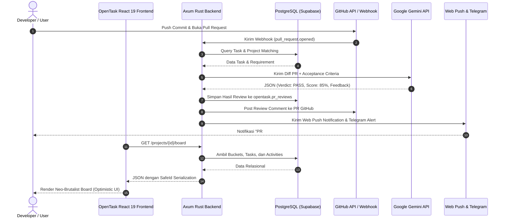

# Perancangan Kebutuhan Perangkat Lunak (RKPL)
# OPENTASK

**Disusun untuk memenuhi Tugas / Assessment Rekayasa Kebutuhan Perangkat Lunak**

```
                       Telkom
                     University
```

**Disusun Oleh:**
- **Evangelion Manuhutu** — 103022300164

**Program Studi S1 Rekayasa Perangkat Lunak**  
**Fakultas Informatika — Universitas Telkom**  
**Bandung, 2026**

---

# BAB I: DESKRIPSI STUDI KASUS

## 1.1 Studi Kasus

Dalam era pengembangan perangkat lunak modern yang menerapkan metodologi *Agile* dan *DevOps*, tim pengembang sering kali dihadapkan pada fragmentasi ekosistem kerja (*tool fatigue*) dan inefisiensi alur kolaborasi:

1. **Bottleneck Code Review dan Kesenjangan Spesifikasi**: Peninjauan *Pull Request* (PR) di repositori kode sering kali memakan waktu berhari-hari karena keterbatasan ketersediaan *Senior Developer*. Selain itu, sering ditemukan situasi di mana kode yang diajukan dalam PR tidak sepenuhnya memenuhi kriteria keberhasilan (*acceptance criteria*) dari tugas yang telah didefinisikan sebelumnya, sehingga memicu siklus revisi berulang yang memperlambat *time-to-market*.
2. **Kehilangan Informasi Pasca Rapat (Meeting Inefficacy)**: Rapat harian (*Daily Standup*), *Sprint Planning*, maupun evaluasi arsitektur menghasilkan banyak diskusi krusial, namun sering kali gagal didokumentasikan menjadi *action items* yang terstruktur. Butir-butir kesepakatan rapat sering kali terlupakan atau tidak sempat dimasukkan ke papan pelacak tugas (*Kanban board*).
3. **Tugas Stagnan Tanpa Radar Deteksi (Task Stagnation)**: Banyak tugas yang telah diambil oleh seorang anggota tim terhenti (*idle*) selama lebih dari 48 jam akibat hambatan teknis (*blocker*) yang tidak segera dikomunikasikan. Akibatnya, *Project Manager* terlambat mengetahui keterlambatan tersebut, dan distribusi beban kerja tim (*workload balance*) menjadi timpang.
4. **Bahaya Presisi Data Identitas Numerik Terdistribusi**: Penggunaan sistem identifikasi global berskala besar berbasis 64-bit integer (*Snowflake ID*) sering kali menimbulkan masalah *data corruption* atau *precision loss* ketika diserialisasikan ke antarmuka berbasis JavaScript/TypeScript (akibat batasan IEEE-754 `Number.MAX_SAFE_INTEGER` sebesar $2^{53}-1$).
5. **Ketergantungan terhadap Aplikasi Terpisah yang Berat**: Penggunaan kombinasi Jira yang rumit, bot notifikasi eksternal, transkrip meeting terpisah, dan perkakas AI berbayar yang tidak terhubung secara native membuat tim pengembang kehilangan fokus (*context switching penalty*).

Berdasarkan permasalahan nyata tersebut, diperlukan sebuah platform manajemen proyek dan pelacak tugas rekayasa perangkat lunak generasi baru yang terpadu, ringan, berkinerja tinggi, dan secara cerdas mengotomatisasi evaluasi kode, ekstraksi notulensi rapat, serta pemantauan tugas secara *real-time*.

## 1.2 Latar Belakang

Manajemen proyek perangkat lunak bukan sekadar memindahkan kartu pada papan visual, melainkan menjaga ritme pengiriman kode yang berkualitas dan dapat diandalkan. Sebagian besar perangkat lunak manajemen proyek yang ada saat ini (seperti Jira, Trello, atau Asana) bersifat umum (*general-purpose*) dan tidak memiliki pemahaman konteks terhadap artefak rekayasa perangkat lunak seperti *Git commits*, *Pull Requests*, *diffs*, dan sintaksis bahasa pemrograman.

Di sisi lain, kehadiran model kecerdasan buatan (*Large Language Models*) seperti Google Gemini membuka peluang revolusioner untuk mengotomatisasi pekerjaan kognitif repetitif, seperti:
- Membaca *diff* kode pada PR dan mencocokkannya dengan deskripsi tugas.
- Mengekstraksi rekaman audio rapat menjadi *Minutes of Meeting* (MoM), keputusan utama, dan daftar tugas aksi.
- Menganalisis beban kerja anggota tim untuk memberikan rekomendasi penugasan ulang (*smart reallocation*).

**OpenTask** dibangun untuk menjawab kebutuhan ini dengan pendekatan antarmuka **Neo-Brutalist**—filosofi desain yang mengutamakan kejujuran visual, kontras tinggi, geometri tegas (*sharp edges*), serta minim distraksi—dipadukan dengan arsitektur backend berkecepatan tinggi berbasis **Rust (Axum + Tokio)** dan frontend **React 19 (TypeScript + Bun)**.

## 1.3 Deskripsi Solusi: OpenTask

**OpenTask** adalah sistem manajemen proyek dan pelacak tugas berbasis web yang mengintegrasikan otomasi AI secara *native*. Fitur-fitur utama OpenTask mencakup:

1. **Interactive Neo-Brutalist Kanban Board**: Visualisasi proyek melalui kolom status (*buckets*) dinamis dengan dukungan *drag-and-drop*, pengaturan bobot tugas (*task weight*), estimasi waktu, serta sinkronisasi instan (*optimistic UI updates*).
2. **GitHub App & Automated AI PR Reviews**: Integrasi langsung dengan repositori GitHub pengguna. Setiap kali ada *Pull Request* baru atau perubahan branch, webhook GitHub akan memicu evaluasi otomatis oleh AI (Google Gemini). AI akan membaca *patch diff*, membandingkannya dengan deskripsi tugas OpenTask, memberikan vonis (*PASS/FAIL*), menghitung skor kelengkapan (*completeness score* 0–100%), dan secara otomatis mengeposkan komentar ulasan langsung ke PR GitHub.
3. **Meeting Intelligence**: Kemampuan memproses transkrip rapat (melalui unggah teks maupun undangan bot otomatis via Recall.ai). AI mengekstrak ringkasan eksekutif MoM, keputusan penting (*key decisions*), serta secara otomatis mengubah butir aksi (*action items*) menjadi draf tugas yang siap dipindahkan ke Kanban board dalam satu klik.
4. **Stagnation Radar & Smart Task Reallocation**: Layanan pekerja latar belakang (*background worker*) yang memindai seluruh tugas dalam status *Ongoing*. Jika suatu tugas tidak memiliki aktivitas selama $\ge 48$ jam, sistem akan mengirimkan peringatan kepada pengembang via Telegram/Web Push dan menyarankan rekomendasi pengalihan tugas kepada anggota tim dengan beban kerja terendah kepada Project Manager.
5. **Multi-Channel Alert System**: Pengiriman pemberitahuan instan melalui Web Push Notifications berstandar VAPID (RFC 8291/8292) langsung ke browser pengguna dan pesan notifikasi interaktif melalui Telegram Bot.
6. **Integritas SafeId 64-bit BigInt**: Penanganan kunci primer Snowflake ID di seluruh lapisan backend dan frontend menggunakan tipe khusus `SafeId` (string serialization), menjamin tidak ada data yang terpotong saat diproses oleh JavaScript.
7. **Dual-Theme Design System**: Dukungan penuh mode Gelap (*Dark*) dan Terang (*Light*) dengan kontras visual tinggi sesuai standar aksesibilitas WCAG 2.1 AA.

## 1.4 Domain Sistem

1. **Software Engineering Project Management & Issue Tracking**: Pengelolaan siklus hidup backlog, sprint, alokasi tugas, status workflow, dan estimasi beban kerja tim pengembang.
2. **Artificial Intelligence & Natural Language Processing (LLM Automation)**: Pemrosesan bahasa alami untuk evaluasi kode sumber (*diff code evaluation*), peringkasan transkrip rapat, dan klasifikasi jenis pekerjaan (*coding*, *design*, *requirement*).
3. **DevOps & Version Control Ecosystem (GitHub Integration)**: Interaksi dengan ekosistem Git melalui GitHub Apps, autentikasi OAuth, Webhook receiver, dan manipulasi GitHub Issues/Pull Requests.
4. **Real-Time Messaging & Multi-Channel Telecommunications**: Komunikasi asinkron menggunakan Web Push API (VAPID) dan integrasi bot perpesanan Telegram.
5. **High-Performance Distributed Systems Architecture**: Penerapan pemrograman sistem berorientasi keamanan memori (*memory-safe*) menggunakan Rust, I/O non-blocking berbasis Tokio, dan koneksi PostgreSQL yang efisien.

## 1.5 Boundary (Batasan Sistem)

Aplikasi OpenTask memiliki batasan-batasan ruang lingkup operasional sebagai berikut:

1. **Cakupan Version Control System**: Pada versi saat ini, integrasi otomatis terbatas pada repositori yang di-hosting di **GitHub** (GitHub Free, Team, dan Enterprise Cloud). Integrasi dengan GitLab, Bitbucket, atau repositori Git lokal mandiri belum didukung.
2. **Penyedia Model Bahasa (AI Engine)**: Layanan kecerdasan buatan utama diintegrasikan dengan **Google Gemini API** (khususnya model `gemini-2.5-flash` dan `gemini-3.6-flash`). Sistem mendukung kunci API bawaan server atau kunci API kustom yang disediakan pengguna/proyek.
3. **Format Transkrip Pertemuan**: Pemrosesan *Meeting Intelligence* menerima masukan teks transkrip terstruktur, file teks, atau melalui bot pencatat yang diintegrasikan via layanan Recall.ai. Sistem tidak melakukan pemrosesan transkripsi suara offline lokal tanpa koneksi internet.
4. **Metode Autentikasi Pengguna**: Autentikasi utama menggunakan akun **GitHub OAuth**, memastikan profil developer terhubung langsung dengan identitas kontributor repositori.
5. **Batasan Kompatibilitas Peramban untuk Push Notifikasi**: Notifikasi *Web Push* memerlukan peramban modern yang mendukung Service Worker dan W3C Push API (Google Chrome, Mozilla Firefox, Microsoft Edge, Safari iOS 16.4+ / macOS).

## 1.6 Context (Konteks Stakeholder & Sistem Terintegrasi)

Sistem OpenTask berinteraksi dengan pengguna langsung dan ekosistem eksternal:

### Stakeholders (Pengguna Langsung)
1. **Software Developer / Engineer**:
   - Menjalankan tugas teknis, mengaitkan branch tugas dengan repositori GitHub.
   - Menerima umpan balik otomatis dari AI atas Pull Request yang diajukan.
   - Mengatur preferensi notifikasi (Web Push dan Telegram) untuk memantau status tugas.
2. **Project Manager / Scrum Master / Tech Lead**:
   - Membuat dan mengonfigurasi proyek baru, mengundang anggota, dan menyusun *bucket* Kanban.
   - Memantau dasbor beban kerja (*current load* vs *capacity*) anggota tim.
   - Menerima peringatan *Stagnation Radar* dan menyetujui rekomendasi pengalihan tugas yang mandek.
   - Mengunggah transkrip rapat ke *Meeting Intelligence* dan menyetujui konversi *action items* menjadi tugas baru.
3. **System Administrator**:
   - Mengelola konfigurasi infrastruktur, *environment variables*, GitHub App Client Secret, dan token global Google Gemini API.
   - Memantau kesehatan sistem via endpoint `/health`.

### Sistem Eksternal Terintegrasi
1. **GitHub API & Webhooks**: Mengirimkan webhook saat ada aktivitas repositori/PR dan menerima postingan komentar evaluasi kode.
2. **Google Gemini Generative AI Service**: Memproses prompt penilaian kelengkapan PR dan ekstraksi MoM meeting.
3. **Recall.ai Service**: Mengirimkan bot pencatat ke dalam URL rapat (Google Meet / Zoom) dan mengirimkan webhook transkrip.
4. **Telegram Bot Platform**: Mengirimkan pesan peringatan dini (*stagnation nudge*) ke akun perpesanan pengembang.
5. **PostgreSQL Database Engine**: Menyimpan seluruh entitas proyek, tasks, buckets, histori aktivitas, alerts, dan kredensial terenkripsi.
6. **Browser Push Service (VAPID)**: Mengalirkan notifikasi langsung ke desktop/mobile pengguna melalui protokol push IETF.

---

# BAB II: AKTIVITAS REQUIREMENTS ELICITATION

## A. Planning

### A.1 Objective (Tujuan Pengembangan)
1. **Meningkatkan Efisiensi Tinjauan Kode**: Memotong waktu tunggu review PR dengan memberikan ulasan awal otomatis oleh AI dalam waktu $\le 8\text{ detik}$, mendeteksi ketidaksesuaian tugas sebelum peninjauan manual oleh rekan kerja (*peer review*).
2. **Menghilangkan Hilangnya Informasi Rapat**: Mengotomatisasi konversi percakapan rapat menjadi *actionable tasks* berbobot di papan Kanban tanpa perlu mengetik ulang notulensi secara manual.
3. **Mencegah Keterlambatan Proyek Akibat Tugas Mandek**: Menyediakan mekanisme deteksi otomatis (*Stagnation Radar*) yang aktif memantau tugas yang tidak tersentuh lebih dari 48 jam dan menyarankan pengalihan tugas secara cerdas.
4. **Memberikan Antarmuka Pengembang yang Cepat dan Ergonomis**: Menyajikan antarmuka visual Neo-Brutalist yang responsif, berbobot rendah, dan nyaman digunakan baik di lingkungan siang hari maupun malam hari (*Dual-Theme*).

### A.2 Visi
Menjadi platform manajemen proyek rekayasa perangkat lunak generasi baru yang paling intuitif, gesit, dan cerdas, di mana setiap baris kode, diskusi rapat, dan kartu tugas terhubung secara harmonis melalui kecerdasan buatan.

### A.3 Tipe Requirement (Model Kano)
Dalam perencanaan elisitasi kebutuhan OpenTask, kebutuhan diklasifikasikan menggunakan pendekatan **Model Kano**:

1. **Must Have (Kebutuhan Dasar / Basic Needs)**:
   Fitur fundamental yang wajib ada agar sistem dapat berfungsi sebagai pelacak tugas dan manajemen proyek yang valid. Ketidakhadiran fitur ini menyebabkan kegagalan sistem.
   *(Contoh: Autentikasi GitHub, CRUD Project, CRUD Bucket/Kolom, CRUD Task, Drag-and-Drop Kanban, SafeId serialization).*
2. **Satisfier (Kebutuhan Kinerja / Performance Needs)**:
   Fitur yang keberadaannya secara linear meningkatkan kepuasan pengguna. Semakin cepat dan lengkap fiturnya, semakin tinggi kepuasan tim pengembang.
   *(Contoh: Evaluasi otomatis AI PR Review, konversi action item rapat menjadi task, notifikasi multi-kanal Web Push & Telegram, metrik beban kerja tim).*
3. **Delighter (Kebutuhan Pemuas / Attractive Needs)**:
   Fitur inovatif tak terduga yang melampaui ekspektasi standar pengguna, memberikan nilai kompetitif unik dan pengalaman kerja yang unggul.
   *(Contoh: Stagnation Radar dengan auto-reallocation suggestion kepada developer dengan beban terendah, undangan bot AI ke Google Meet/Zoom via Recall.ai, tema ganda Neo-Brutalist dengan zero-freeze optimistic updates).*

### A.4 Teknik Elisitasi
1. **Document-Centric Reuse**: Menelaah dokumentasi, alur kerja, dan kelemahan dari platform sejenis (Jira, Linear, GitHub Projects, Trello) untuk merumuskan daftar fitur mendasar (*Must Have*).
2. **Wawancara Terstruktur & Mendalam (In-Depth Interviews)**: Melakukan sesi wawancara langsung dengan para praktisi rekayasa perangkat lunak (Software Developer, Tech Lead/Project Manager, dan Administrator Infrastruktur) untuk menggali tantangan nyata di lapangan dan merumuskan fitur *Satisfier*.
3. **Brainstorming & Rapid Prototyping**: Diskusi intensif tim pengembang internal untuk mengeksplorasi integrasi model LLM (Google Gemini) ke dalam alur kerja Git, merumuskan fitur *Delighter* seperti *Stagnation Radar* dan integrasi bot pertemuan.

### A.5 User Class

| Class Pengguna | Target Pengguna | Estimasi Pengguna | Deskripsi & Karakteristik | Peran & Interaksi Utama |
| :--- | :--- | :--- | :--- | :--- |
| **Primary User: Software Developer** | Software Engineer, Frontend/Backend Dev | 500+ Pengguna Aktif | Mahir menggunakan Git/GitHub, bekerja berdasarkan tiket tugas, menghargai kecepatan antarmuka dan minim klik. | Mengambil tugas di Kanban, membuat branch, mengajukan PR, membaca hasil evaluasi AI di GitHub, menerima peringatan tugas stagnan di Telegram/Web Push. |
| **Secondary User: Tech Lead / Project Manager** | Project Manager, Scrum Master, Lead Dev | 100+ Pengguna Aktif | Bertanggung jawab atas *delivery timeline*, alokasi beban anggota tim, dan dokumentasi sprint. | Membuat proyek, menyusun struktur bucket, memantau *workload metrics*, meninjau saran pengalihan tugas dari *Stagnation Radar*, menganalisis MoM rapat. |
| **System Administrator** | DevOps / Lead Architect | 10 Pengguna Admin | Memiliki akses ke konfigurasi server, kredensial GitHub App, database Supabase, dan kuota LLM. | Mengatur kunci API global, memantau log sistem dan error rate, memvalidasi webhook delivery, memastikan ketersediaan layanan. |

---

## B. Preparation

### B.1 Jadwal Kegiatan dan PIC Elisitasi

| No | Tahapan Kegiatan | Tanggal Mulai | Tanggal Selesai | Penanggung Jawab (PIC) |
| :---: | :--- | :---: | :---: | :--- |
| 1 | Telaah Dokumen & Studi Komparasi (Linear, Jira, GH Projects) | 12/Sep/2026 | 13/Sep/2026 | Evangelion Manuhutu, Gumilar Hari Subagja |
| 2 | Penyusunan Instrumen Kuesioner Pengembang | 14/Sep/2026 | 14/Sep/2026 | Benaya Giuseppe, Yudha Harwamto |
| 3 | Penyebaran Kuesioner Online ke Komunitas Developer | 15/Sep/2026 | 17/Sep/2026 | Syahdan Mansiz, Gumilar Hari Subagja |
| 4 | Pelaksanaan Wawancara dengan Software Developer | 18/Sep/2026 | 18/Sep/2026 | Evangelion Manuhutu, Benaya Giuseppe |
| 5 | Pelaksanaan Wawancara dengan Project Manager / Tech Lead | 19/Sep/2026 | 19/Sep/2026 | Evangelion Manuhutu, Yudha Harwamto |
| 6 | Pelaksanaan Wawancara dengan DevOps / System Administrator | 20/Sep/2026 | 20/Sep/2026 | Syahdan Mansiz, Gumilar Hari Subagja |
| 7 | Sesi Brainstorming Arsitektur AI & Fitur Inovatif | 21/Sep/2026 | 21/Sep/2026 | Seluruh Tim Pengembang OpenTask |
| 8 | Sintesis Kebutuhan & Pemodelan Matriks Kebutuhan Fungsional | 22/Sep/2026 | 23/Sep/2026 | Evangelion Manuhutu, Benaya Giuseppe |
| 9 | Tinjauan Kelayakan Teknis (Feasibility Test: Axum, Gemini API) | 24/Sep/2026 | 25/Sep/2026 | Evangelion Manuhutu, Syahdan Mansiz |
| 10 | Finalisasi Dokumen RKPL dan Quality Attributes | 26/Sep/2026 | 27/Sep/2026 | Seluruh Tim Pengembang OpenTask |

### B.2 Perencanaan Elisitasi

#### B.2.1 Document-Centric Reuse
Tim melakukan analisis mendalam terhadap alat manajemen proyek yang beredar di pasar:
- **Jira Software**: Fitur sangat lengkap namun memiliki waktu muat (*initial loading time*) yang lambat ($>3\text{ detik}$) dan konfigurasi yang rumit (*over-engineered* untuk tim skala menengah).
- **Linear App**: Memiliki kecepatan interaksi sangat tinggi dan desain minimalis, namun integrasi AI terbatas pada asisten pencarian teks dan belum otomatis memvalidasi kelengkapan *code diff* terhadap acceptance criteria tugas secara mandiri.
- **GitHub Projects**: Terintegrasi erat dengan issues dan PR, namun papan visualnya minim dukungan otomatisasi cerdas pasca rapat (*Meeting Intelligence*) dan tidak memiliki radar pemantauan tugas mandek (*Stagnation Alert*).
- **Trello**: Sangat sederhana dan mudah digunakan, namun tidak memiliki konsep native untuk *branch tracking*, integrasi webhook CI/CD, dan mitigasi ID precision pada sistem skala besar.

#### B.2.2 Kuesioner Kebutuhan Pengembang
Instrumen kuesioner disebarkan kepada 65 responden (terdiri dari software developer dan tech lead di lingkungan akademis dan industri startup).

**Daftar Pertanyaan Kuesioner:**
1. Berapa lama rata-rata waktu yang dibutuhkan rekan setim Anda untuk me-review sebuah Pull Request?
2. Seberapa sering PR yang Anda buat harus direvisi karena ada kriteria tugas yang terlewatkan?
3. Apakah notulensi rapat sprint planning Anda selalu berhasil dikonversi menjadi tiket tugas secara rapi?
4. Seberapa sering terjadi situasi di mana sebuah tugas tidak tersentuh selama berhari-hari tanpa disadari oleh Project Manager?
5. Apakah Anda merasa terbantu jika AI secara otomatis meninjau *code diff* PR Anda dan memberi komentar sebelum di-review manusia?
6. Saluran notifikasi mana yang paling cepat Anda respons saat ada tugas darurat (Email, In-App, Web Push, atau Telegram)?
7. Apakah tampilan kontras tinggi (Neo-Brutalist) dengan dukungan mode gelap/terang membantu fokus Anda dalam bekerja?

#### B.2.3 Wawancara Mendalam
Disusun daftar pertanyaan terarah untuk 3 profil narasumber:
- **Pewawancara Developer**: Fokus pada kecepatan pembuatan kartu, kaitan kode branch dengan tugas, notifikasi PR review, dan kemudahan navigasi.
- **Pewawancara Project Manager**: Fokus pada visibilitas progres sprint, beban kerja tim (*workload capacity*), efisiensi rapat, dan mitigasi tugas macet.
- **Pewawancara Administrator / DevOps**: Fokus pada keamanan token GitHub, integrasi webhook yang andal, konsumsi memori backend, dan isolasi data per proyek.

---

## C. Perform (Pelaksanaan & Analisis Hasil)

### C.1 Hasil Document-Centric Reuse

Berdasarkan telaah fitur pada perkakas pembanding, diidentifikasi kebutuhan fitur yang diadopsi dan ditingkatkan ke dalam OpenTask:

| No | Fitur yang Diteliti | Referensi Asal | Relevansi untuk OpenTask | Kategori Kano |
| :---: | :--- | :--- | :--- | :--- |
| 1 | Visual Kanban Board dengan Drag & Drop | Trello, Linear | Mempermudah penataan alur kerja tiket secara visual. | **Must Have** |
| 2 | Otentikasi GitHub Terpadu | GitHub Projects | Memastikan profil terhubung dengan kontributor kode sumber. | **Must Have** |
| 3 | Kategorisasi Bucket Kustom (Todo, In Dev, Done) | Jira, Linear | Memberikan fleksibilitas alur kerja tim. | **Must Have** |
| 4 | Penugasan Anggota (*Assignee*) & Estimasi Poin | Jira | Menetapkan akuntabilitas dan estimasi kapasitas tugas. | **Must Have** |
| 5 | Tinjauan Otomatis AI terhadap Kode PR | Inovasi OpenTask | Memeriksa kriteria tugas terhadap *diff* PR via Google Gemini. | **Satisfier** |
| 6 | Multi-Channel Alert (Web Push & Telegram) | Inovasi OpenTask | Mencegah pesan penting terlewatkan tanpa membuka browser. | **Satisfier** |
| 7 | Dasbor Metrik Proyek & Workload | Linear Insights | Memonitor kapasitas dan penyelesaian sprint secara grafis. | **Satisfier** |
| 8 | Meeting Intelligence (Transkrip $\rightarrow$ Tasks) | Inovasi OpenTask | Mengonversi percakapan rapat menjadi action items otomatis. | **Delighter** |
| 9 | Stagnation Radar dengan Auto Reallocation | Inovasi OpenTask | Mendeteksi tugas menganggur $>48$ jam dan merekomendasikan penerus. | **Delighter** |
| 10 | SafeId 64-bit BigInt Architecture | Twitter Snowflake | Menjamin integritas referensial ID berskala besar tanpa pembulatan. | **Must Have** |

### C.2 Hasil Kuesioner

Dari 65 responden pengembang dan manajer proyek, diperoleh temuan kuantitatif:
- **81.5%** responden menyatakan bahwa proses review PR sering menjadi penghambat (*bottleneck*) utama penyelesaian fitur.
- **73.8%** mengakui bahwa hasil rapat teknis sering kali tidak segera dituangkan menjadi tiket kerja dan butuh waktu manual 30–60 menit untuk merapikannya.
- **69.2%** mengalami masalah di mana tugas terbengkalai selama lebih dari 2 hari karena developer mengalami kendala tanpa melapor.
- **89.2%** menyambut positif hadirnya asisten AI yang dapat memvalidasi kesesuaian PR secara otomatis di GitHub sebelum *human approval*.
- **84.6%** memilih Telegram dan Browser Web Push sebagai saluran notifikasi yang paling efektif untuk memotong waktu respons dibandingkan email.

### C.3 Wawancara Mendalam dengan Pengguna

#### C.3.1 Wawancara Software Developer
- **Narasumber**: Dimas Arya Pratama (Senior Frontend Engineer)
- **Tanya (Q)**: Apa kendala terbesar Anda sehari-hari saat menggunakan task management tool seperti Jira atau Trello?
- **Jawab (A)**: *"Jira terasa sangat lambat dan terlalu banyak formulir yang tidak perlu diisi. Saya hanya butuh membuat tugas, menentukan branch Git, lalu fokus coding. Selain itu, saya sering menunggu berhari-hari hanya untuk PR kecil saya di-merge, padahal isinya sudah sesuai. Kalau ada AI yang bisa memverifikasi dulu bahwa PR ini sudah mencakup semua requirement task, itu akan sangat membantu mempercepat proses approval."*
- **Tanya (Q)**: Bagaimana pendapat Anda mengenai notifikasi yang saat ini Anda terima?
- **Jawab (A)**: *"Email notifikasi biasanya langsung masuk spam atau terabaikan. Kalau ada notifikasi langsung ke Telegram atau Web Push yang memberi tahu status PR atau jika tugas saya terdeteksi mandek, saya bisa langsung merespons."*

**Analisis Wawancara Developer:**
Pengembang menginginkan alat yang berfokus pada kecepatan, minim friksi formulir, terhubung erat dengan branch Git, dan memiliki otomatisasi AI yang dapat memberikan validasi awal terhadap Pull Request.

#### C.3.2 Wawancara Tech Lead / Project Manager
- **Narasumber**: Sarah Anindita, S.T., M.Kom. (Scrum Master & Technical Lead)
- **Tanya (Q)**: Bagaimana Anda mengelola hasil rapat sprint planning dan meeting darurat bersama tim?
- **Jawab (A)**: *"Rapat sering kali berjalan intensif, banyak keputusan teknis diambil. Tapi setelah rapat selesai, butuh waktu yang cukup lama bagi saya untuk merangkum MoM dan membagi-baginya menjadi kartu tugas individual. Sangat ideal jika sistem bisa membaca transkrip meeting dan langsung menghasilkan draf action item beserta estimasi bobotnya."*
- **Tanya (Q)**: Apa tantangan terbesar Anda dalam menjaga ketepatan waktu sprint?
- **Jawab (A)**: *"Banyak developer yang enggan mengaku saat menghadapi blocker di tengah sprint. Tahu-tahu saat daily standup tugasnya belum jalan selama 3 hari. Saya butuh radar yang memberi sinyal jika ada tugas yang stagnan dan kalau bisa langsung merekomendasikan siapa anggota tim yang sedang memiliki kapasitas senggang untuk membantu."*

**Analisis Wawancara Project Manager:**
Tech Lead membutuhkan fitur cerdas yang menyederhanakan dokumentasi rapat menjadi tindakan nyata (*Meeting Intelligence*) serta sistem deteksi dini (*Stagnation Radar*) yang menjaga alur sprint tetap bergerak tanpa keterlambatan tersembunyi.

#### C.3.3 Wawancara DevOps / System Administrator
- **Narasumber**: Rian Hidayat (DevOps & Infrastructure Engineer)
- **Tanya (Q)**: Dari sudut pandang infrastruktur, apa hal terpenting dalam memilih sistem kolaborasi tim?
- **Jawab (A)**: *"Sistem harus ringan, hemat resource, dan aman. Kami tidak ingin aplikasi task management memakan RAM server gigabyte-an hanya untuk melayani beberapa ratus request. Penggunaan Rust di backend adalah nilai tambah yang luar biasa karena konsumsi memorinya sangat minim dan tidak ada garbage collection pause. Kunci API AI dan token GitHub juga harus terlindungi ketat dan tidak boleh bocor ke client-side."*
- **Tanya (Q)**: Bagaimana pandangan Anda tentang keandalan sinkronisasi ID di database terdistribusi?
- **Jawab (A)**: *"Sangat berbahaya jika backend mengirimkan integer 64-bit (Snowflake) mentah ke frontend JavaScript karena angka di atas $2^{53}-1$ akan terpotong atau dibulatkan. Kami menyarankan serialisasi string wajib (SafeId) di seluruh DTO JSON."*

**Analisis Wawancara DevOps:**
Fokus utama adalah efisiensi komputasi, keandalan penanganan kunci primer 64-bit (*SafeId*), isolasi kredensial rahasia (API keys/OAuth tokens), dan ketahanan pemrosesan webhook secara asinkron.

---

## D. Follow Up: Spesifikasi Kebutuhan Fungsional (Functional Requirements)

Berdasarkan keseluruhan tahapan elisitasi di atas, berikut adalah matriks spesifikasi kebutuhan fungsional perangkat lunak OpenTask:

| Kode REQ | Nama Kebutuhan | User Story | Tipe (Kano) | Kriteria Keberhasilan Terukur |
| :---: | :--- | :--- | :---: | :--- |
| **REQ-01** | Autentikasi Pengguna via GitHub OAuth | Sebagai pengguna, saya ingin dapat masuk ke dalam sistem menggunakan akun GitHub saya, sehingga identitas kerja dan repositori saya langsung terhubung tanpa perlu mendaftar ulang. | **Must Have** | Pengguna berhasil login melalui GitHub OAuth, token sesi disimpan dengan aman, dan diarahkan kembali ke halaman dashboard dalam $\le 2\text{ detik}$. |
| **REQ-02** | Manajemen Proyek (CRUD Projects) | Sebagai Project Manager, saya ingin membuat, mengubah, melihat daftar, dan menghapus proyek kerja, agar setiap inisiatif pengembangan dapat dikelompokkan dengan rapi. | **Must Have** | Pengguna dapat membuat proyek baru dengan nama, deskripsi, dan repositori tertaut. Data tersimpan di PostgreSQL dengan ID Snowflake yang unik. |
| **REQ-03** | Manajemen Bucket / Kolom Kanban | Sebagai pengguna, saya ingin membuat dan mengatur kolom status (misal: Backlog, Ongoing, In Review, Done) pada proyek, sehingga alur kerja tim dapat disesuaikan. | **Must Have** | Kolom status dapat ditambahkan, diubah urutannya (*order_idx*), dan dihapus secara dinamis dengan sinkronisasi instan ke database. |
| **REQ-04** | Manajemen Kartu Tugas (CRUD Tasks) | Sebagai pengembang, saya ingin membuat tiket tugas yang memiliki judul, deskripsi markdown, tipe (Code, Design, Bug), bobot nilai (1–8), dan target branch Git. | **Must Have** | Kartu tugas berhasil dibuat, memiliki ID 64-bit *SafeId*, dan tampil di dalam bucket yang sesuai pada papan visual. |
| **REQ-05** | Drag-and-Drop & Reordering Interaktif | Sebagai pengembang, saya ingin memindahkan kartu tugas antar kolom dan mengubah posisinya secara drag-and-drop, agar pembaruan status dapat dilakukan dengan cepat. | **Must Have** | Kartu dapat dipindahkan antar kolom dengan animasi mulus (60 FPS); status dan urutan (*order_idx*) tersimpan otomatis di backend via endpoint `/tasks/reorder`. |
| **REQ-06** | Penjaminan Presisi SafeId 64-bit | Sebagai sistem, saya ingin memastikan seluruh ID entitas 64-bit diserialisasikan sebagai string dalam format JSON, sehingga tidak terjadi pembulatan angka di browser. | **Must Have** | Seluruh field `id`, `project_id`, dan `bucket_id` diterima dan dikirimkan sebagai string numerik valid tanpa ada pemotongan bit IEEE-754. |
| **REQ-07** | Integrasi Repositori GitHub & Webhook | Sebagai Tech Lead, saya ingin menautkan repositori GitHub ke proyek OpenTask, sehingga event commit dan PR dapat didengarkan secara otomatis melalui webhook. | **Must Have** | Webhook GitHub berhasil diverifikasi; sistem mencatat instalasi GitHub App dan menautkan event repositori ke ID proyek yang tepat. |
| **REQ-08** | Evaluasi Otomatis AI terhadap Pull Request | Sebagai pengembang, saya ingin PR yang saya ajukan di GitHub secara otomatis dievaluasi oleh Google Gemini AI terhadap deskripsi tugas terkait di OpenTask. | **Satisfier** | AI menganalisis diff PR, membandingkan dengan tugas yang cocok, menghasilkan vonis (*PASS/FAIL*), skor kelengkapan (0–100%), dan mengeposkan komentar ke PR dalam $\le 8\text{ detik}$. |
| **REQ-09** | Riwayat dan Dasbor PR Reviews | Sebagai Tech Lead, saya ingin melihat riwayat seluruh evaluasi PR yang dilakukan oleh AI beserta umpan balik detailnya, agar saya dapat memverifikasi kualitas pekerjaan tim. | **Satisfier** | Halaman detail proyek menampilkan tab riwayat PR Review dengan filter berdasarkan status vonis dan skor kelengkapan kode. |
| **REQ-10** | Meeting Intelligence: Ekstraksi MoM Otomatis | Sebagai Project Manager, saya ingin mengunggah transkrip rapat ke sistem dan meminta AI mengekstrak ringkasan eksekutif, keputusan utama, dan butir tindakan (*action items*). | **Satisfier** | AI memproses transkrip rapat dalam $\le 5\text{ detik}$ dan menampilkan hasil MoM terstruktur dengan format JSON valid. |
| **REQ-11** | Konversi Action Items Menjadi Tugas Kanban | Sebagai Project Manager, saya ingin memilih butir tindakan (*action items*) hasil analisis rapat dan mengubahnya langsung menjadi kartu tugas di Kanban board dengan satu klik. | **Satisfier** | Sistem secara massal (*batch create*) menyisipkan kartu tugas baru ke dalam bucket proyek yang dipilih berdasarkan data action items rapat. |
| **REQ-12** | Integrasi Bot Rapat Otomatis (Recall.ai) | Sebagai pengguna, saya ingin memasukkan tautan Google Meet atau Zoom agar bot OpenTask dapat bergabung dan merekam percakapan rapat secara otomatis. | **Delighter** | Sistem mengirimkan perintah ke API Recall.ai untuk menerjunkan bot pencatat ke ruang rapat dan menerima webhook hasil rekaman/transkrip saat rapat selesai. |
| **REQ-13** | Stagnation Radar (Deteksi Tugas Macet) | Sebagai Project Manager, saya ingin sistem secara proaktif mendeteksi tugas berstatus *Ongoing* yang tidak memiliki aktivitas pengembangan selama $>48$ jam. | **Delighter** | Background worker memindai database secara periodik, menandai tugas yang terhenti, dan memicu peringatan ke pengguna serta Project Manager. |
| **REQ-14** | Rekomendasi Realokasi Tugas Cerdas | Sebagai Project Manager, saya ingin sistem menyarankan anggota tim yang memiliki beban kerja terendah untuk menggantikan tugas yang terdeteksi stagnan. | **Delighter** | Sistem menghitung *current_load* setiap anggota tim berpekerjaan sejenis, memilih kandidat dengan beban terminimal, dan menampilkannya sebagai *suggested_assignee*. |
| **REQ-15** | Notifikasi Browser Instan (Web Push VAPID) | Sebagai pengembang, saya ingin menerima notifikasi web push langsung di desktop/ponsel saat PR saya selesai dievaluasi atau saat ada tugas darurat yang ditugaskan ke saya. | **Satisfier** | Pengguna dapat melakukan langganan (*subscribe*) Web Push; sistem mengirimkan notifikasi terenkripsi (RFC 8291/8292) yang tampil meskipun tab aplikasi ditutup. |
| **REQ-16** | Integrasi Peringatan via Telegram Bot | Sebagai pengembang, saya ingin menghubungkan akun Telegram saya ke OpenTask, agar saya dapat menerima pesan peringatan *stagnation alert* langsung di Telegram. | **Satisfier** | Pengguna menautkan Telegram Chat ID; sistem mengirimkan pesan peringatan terformat saat tugas mengalami stagnasi waktu. |
| **REQ-17** | Manajemen Kunci API AI Kustom | Sebagai pemilik proyek, saya ingin dapat menyetel Google Gemini API Key pribadi untuk proyek saya, sehingga penggunaan kuota AI terisolasi dan tidak bergantung pada kunci global. | **Satisfier** | Pengguna dapat menyimpan kunci API Gemini di level proyek/user; sistem melakukan validasi koneksi (*test ping*) dan menyamarkan (*masking*) tampilan kunci. |
| **REQ-18** | Dasbor Metrik Beban Kerja & Histori Proyek | Sebagai Tech Lead, saya ingin melihat grafik kemajuan proyek, ringkasan skor KPI anggota, serta log aktivitas tim secara kronologis. | **Satisfier** | Dasbor proyek menyajikan metrik kemajuan tugas, rincian aktivitas tim (*audit log*), dan indikator beban kerja per anggota tim. |
| **REQ-19** | Dukungan Tema Ganda (Dark & Light Mode) | Sebagai pengguna, saya ingin dapat memilih tema tampilan gelap atau terang sesuai dengan kenyamanan visual saya tanpa merusak kontras teks. | **Satisfier** | Antarmuka berganti tema secara instan ($\le 50\text{ ms}$) dengan seluruh komponen mempertahankan rasio kontras teks $\ge 4.5:1$ (WCAG AA). |
| **REQ-20** | Endpoint Health Check & Telemetri Server | Sebagai System Administrator, saya ingin dapat memeriksa status kesehatan server dan konektivitas database melalui endpoint API `/health`. | **Must Have** | Endpoint `/health` mengembalikan status JSON `{"status": "ok", "db": true}` dalam waktu $\le 20\text{ ms}$. |

---

# LAMPIRAN

## Lampiran 1: Catatan Minute of Meeting (MoM) Penyusunan Kebutuhan OpenTask

### Rapat 1: Penentuan Visi & Inisiasi Kebutuhan
- **Waktu Pelaksanaan**: Sabtu, 12 September 2026, Pukul 19.30 – 21.00 WIB
- **Media**: Discord & Google Meet
- **Peserta**:
  1. Evangelion Manuhutu (103022300164)
  2. Gumilar Hari Subagja (103022300137)
  3. Yudha Harwamto Putra (103022300010)
  4. Syahdan Mansiz Kurniawan (103022300079)
  5. Benaya Giuseppe Linggaputra S. (103022330122)
- **Agenda Diskusi**:
  1. Identifikasi masalah nyata pada alur kerja tim developer modern (review PR yang lama, tugas macet, hasil meeting hilang).
  2. Pembahasan konsep pembeda OpenTask dibandingkan alat pelacak tugas konvensional (Jira, Trello).
  3. Kesepakatan penggunaan antarmuka Neo-Brutalist dan adopsi backend performa tinggi (Rust Axum).

### Rapat 2: Perumusan Domain, Boundary, dan Context
- **Waktu Pelaksanaan**: Kamis, 17 September 2026, Pukul 20.00 – 22.00 WIB
- **Media**: Discord Server
- **Peserta**: Seluruh Anggota Tim
- **Agenda Diskusi**:
  1. Menetapkan batasan sistem (*boundary*): fokus integrasi ke GitHub dan Google Gemini API.
  2. Merumuskan instrumen kuesioner dan daftar narasumber wawancara.
  3. Pembagian tugas PIC elisitasi dan jadwal wawancara praktisi industri.

### Rapat 3: Analisis Hasil Wawancara & Perumusan Model Kano
- **Waktu Pelaksanaan**: Selasa, 22 September 2026, Pukul 19.00 – 21.30 WIB
- **Media**: Google Meet
- **Peserta**: Seluruh Anggota Tim
- **Agenda Diskusi**:
  1. Membahas masukan dari developer mengenai pentingnya evaluasi PR instan via AI.
  2. Membahas kebutuhan Project Manager terhadap *Stagnation Radar* dan otomatisasi MoM rapat.
  3. Mengelompokkan kebutuhan ke dalam kategori *Must Have*, *Satisfier*, dan *Delighter* pada Model Kano.

### Rapat 4: Finalisasi Spesifikasi Kebutuhan & Uji Kelayakan Teknis
- **Waktu Pelaksanaan**: Sabtu, 26 September 2026, Pukul 14.00 – 17.00 WIB
- **Media**: Offline Lab Informatika & Hybrid Discord
- **Peserta**: Seluruh Anggota Tim
- **Agenda Diskusi**:
  1. Memverifikasi 20 butir Kebutuhan Fungsional (REQ-01 hingga REQ-20).
  2. Menguji coba prototype *SafeId* 64-bit pada browser untuk memastikan tidak ada pemotongan angka.
  3. Menyetujui finalisasi dokumen RKPL dan Quality Attributes untuk diserahkan.

---

## Lampiran 2: Dokumentasi Alur Arsitektur Sistem OpenTask


